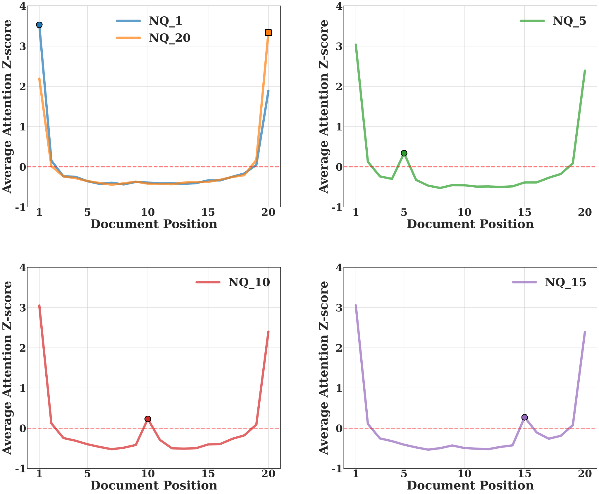
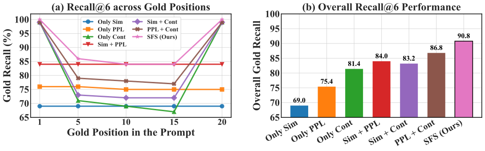
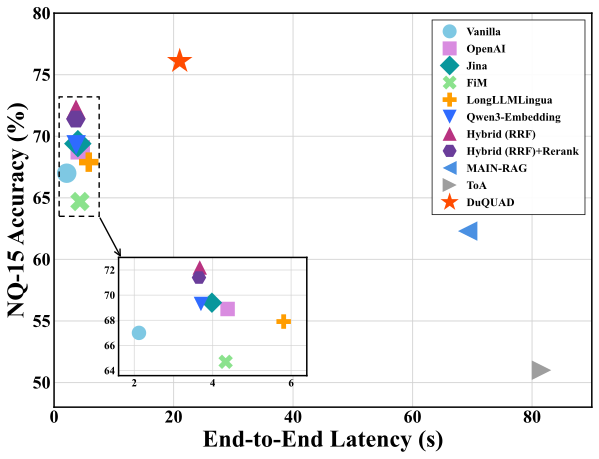

## Motivation

LLMs attend most strongly to documents at the beginning and end of the context. When the answer-bearing document sits in the middle, the boundaries still dominate and the evidence is underused. Existing fixes such as document reordering or attention steering rely on weak signals like semantic similarity or raw attention, so they break down when the useful document is buried among noisy distractors.

<figure class="paper-figure">
  
  <figcaption>Attention z-scores across document positions on Natural Questions (NQ-n: the answer document is at position n). Attention is highest at the boundaries, but a local spike appears around the answer document even in the middle.</figcaption>
</figure>

This W-shaped pattern shows that the answer document leaves a local trace in attention even when the model does not use it well. DuQUAD turns this spike into a signal for finding the right documents, and combines it with two complementary views of the context.

## Method

DuQUAD has four stages, shown in the overview figure at the top.

**1. Structural Fusion Score (SFS).** Each document is scored with three signals: semantic relevance (embedding similarity to the question), structural inference (how well the document supports generating the question), and attention contrast (local attention spikes that are robust to position). The top documents are passed to the Local Agent.

**2. Dual-view agents.** The Local Agent reasons over the small, SFS-prioritized subset to recover evidence hidden in the middle. The Global Agent reasons over the full document set so that cross-document context is not lost. Each agent answers with citations and marks its most important documents.

**3. Quality-aware evidence pruning.** The important documents from both agents are merged, scored for reliability (DocScore), and low-confidence documents are removed. The remaining documents are refined into sentence-level evidence.

**4. Judge Agent.** The final answer is produced from the two agents' reasoning, the document scores, and the sentence-level evidence.

## Results

DuQUAD was evaluated on Natural Questions (with the answer document placed at different positions among 20 documents), MuSiQue, and HotpotQA, using Llama-3.1-8B-Instruct and Qwen2.5-7B-Instruct. It achieves the best accuracy in all 14 settings, outperforming reordering, reranking, context optimization, and multi-agent baselines.

  

    14 / 14
    Best accuracy in all evaluated settings
  

  

    90.8%
    Gold evidence recall
  

  

    3.3–3.9×
    Lower latency than existing multi-agent frameworks
  

### Finding the answer document

Each SFS signal alone misses many answer documents: semantic relevance, structural inference, and attention contrast reach 69.0%, 75.4%, and 81.4% recall. Combining all three raises recall to 90.8%, 9.4% higher than the best single signal, and keeps recall high wherever the answer document is placed.

<figure class="paper-figure">
  
  <figcaption>Recall of the answer document with different combinations of SFS signals. (a) Recall by answer position. (b) Overall recall.</figcaption>
</figure>

### Every component matters

Removing any component lowers accuracy. Removing the Local Agent hurts most on NQ-15, where the answer document is buried among distractors, while multi-hop questions in MuSiQue depend more on the Global Agent and evidence pruning.

| Accuracy (%)        |  NQ-15   | MuSiQue  | HotpotQA |
| :------------------ | :------: | :------: | :------: |
| w/o Local Agent     |   69.8   |   38.1   |   79.1   |
| w/o Global Agent    |   71.1   |   36.1   |   80.0   |
| w/o Quality Pruning |   71.3   |   34.6   |   79.8   |
| **DuQUAD**          | **76.1** | **41.1** | **80.2** |

### Accurate and efficient

Lightweight retrieval and reranking methods are faster but less accurate. Compared with the multi-agent frameworks MAIN-RAG and ToA, DuQUAD is more accurate and 3.3× and 3.9× faster end to end.

<figure class="paper-figure">
  
  <figcaption>Accuracy vs. end-to-end latency on NQ-15. The inset magnifies the low-latency region.</figcaption>
</figure>
