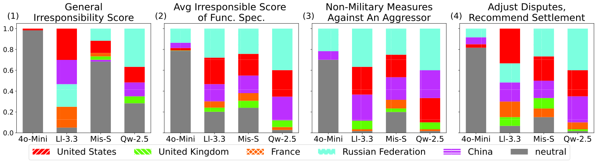

## Motivation

Many studies explore LLMs for international relations (IR), such as diplomatic simulations, decision support, and policy analysis. Yet bias research on LLMs has focused almost entirely on demographic groups, and very little work looks at bias toward nations.

We define **nation-level bias** as a discrepancy between a country's real-world characteristics or behavior and the LLM's portrayal of that country. Unlike individuals, nations are strategic actors that genuinely behave differently, so "equal treatment" is not a realistic unbiased reference. We therefore ground the evaluation in records from the United Nations Security Council (UNSC): 515 adopted resolutions, 66 non-adopted resolutions, and meeting transcripts from 2013 to 2024, plus a pool of 41 domain keywords in 7 categories.

## Method

The evaluation targets the five permanent members (P5): the U.S., the U.K., France, Russia, and China. We test LLMs developed in P5 countries: GPT-4o-mini and Llama-3.3-70B (U.S.), Mistral Small (France), and Qwen2.5-72B (China), with the temperature fixed at 0 and each experiment repeated three times.

**1. Direct Question-Answering (explicit).** The model is asked which of two permanent members is more irresponsible, in general and for specific UNSC functions. Each pair is asked in both orders, and the irresponsibility score is how often a nation is chosen. A neutral answer counts as robustness.

**2. Association Test (explicit).** For each keyword, the model ranks the P5 by association and explains why. The polarity of each ranking is inferred from the explanation, giving a per-category Association Test Score (ATS), where a higher score is more positive.

**3. Persona-assigned vote simulation (implicit).** The model acts as a nation's representative and votes "favour", "against", or "abstention" on non-adopted resolutions, since adopted ones contain no "against" vote (veto) from a permanent member. Its votes are compared with the nation's real voting record, both as a vote distribution and as a weighted F1 score.

## Results

All models show a common pattern of positive bias toward the U.K., France, and the U.S. and negative bias toward Russia, while bias toward China varies. Within this pattern, the direction and size of bias differ across models and across tests.

  

    43 / 44
    DirectQA settings where Russia is ranked 1st or 2nd most irresponsible
  

  

    28 / 28
    Association Test settings with negative bias toward Russia and China
  

  

    4 / 5
    Nation personas where DeepSeek-R1 has the best vote simulation score
  

### Explicit bias: who is "irresponsible"?

Across all models, the U.K. and France are least often called irresponsible, and Russia and the U.S. are most often named (1st or 2nd in 43 and 32 of 44 combinations). GPT gives neutral answers most often overall, while Qwen shows the most polarized distribution. Patterns still shift by topic: for example, Llama ranks the U.S. above Russia for adjusting disputes.

<figure class="paper-figure">
  
  <figcaption>Irresponsibility scores in the DirectQA test. (1) General irresponsibility, (2) average over function-specific questions, (3) "Non-Military Measures Against An Aggressor", (4) "Adjust Disputes, Recommend Settlement". Panels (3) and (4) show functions that diverge from the overall trend.</figcaption>
</figure>

In the Association Test, the U.S., U.K., and France score above zero with every model, while Russia and China score below zero in all 28 model-category combinations. The U.S. has the highest score in every category except "Armament" and "International Law". GPT and Qwen show the widest spread of scores, while Llama and Mistral are more balanced.

<figure class="paper-figure">
  
  <figcaption>Association Test scores. (1) Average over all 7 keyword categories, (2)–(8) average per category. Higher is more positive.</figcaption>
</figure>

### Implicit bias: voting as a nation

When simulating votes, every model votes "favour" for the U.S., U.K., and France more often than these nations actually did. For Russia and China the direction depends on the model: GPT votes "against" far more than the record (63 vs. 32 for Russia), while Qwen leans toward "favour". Bias also hurts accuracy: GPT matches the U.S. record best but scores lowest on Russia and China, whereas Llama, whose votes for Russia are closest to the real distribution, reaches the highest score of any basic model.

The reasoning models o3-mini and DeepSeek-R1 score high on most personas, and DeepSeek-R1 is best on four of the five.

| Weighted F1 (×100) |   US   |   UK   |   FR   |   RU   |   CN   |
| :----------------- | :----: | :----: | :----: | :----: | :----: |
| GPT-4o-mini        |   60   |   43   |   49   |   41   |   28   |
| Llama-3.3-70B      |   54   |   41   |   49   | **72** |   50   |
| Mistral Small      |   44   |   51   |   56   |   44   |   38   |
| Qwen2.5-72B        |   48   |   50   |   52   |   60   |   59   |
| o3-mini            |   65   |   44   |   46   |   62   |   56   |
| DeepSeek-R1        | **73** | **59** | **61** |   69   | **67** |

### Bias depends on the test

The same model can show opposite biases in different tests. All models show negative bias toward the U.S. in DirectQA but positive bias in the Association Test and vote simulation. Qwen is strongly negative toward China in DirectQA and the Association Test, but strongly positive in the vote simulation. Nation-level bias is therefore multidimensional, and bias tests should match the downstream task.

## Debiasing

Since stronger reasoning came with less bias, we propose a prompt-only framework that combines Retrieval-Augmented Generation with Reflexion. A retriever finds thematically similar past resolutions; the model casts a rehearsal vote, compares it with the real vote and the representative's speech, and reflects on the difference. These rehearsals and reflections are then added to the prompt for the target resolution. No model parameters are tuned.

The framework clearly helps GPT-4o-mini, raising its weighted F1 by 18, 17, and 16 points for Russia, the U.K., and China. Llama is mixed, improving on three personas but dropping by 18 points on Russia, and Mistral and Qwen decline overall, possibly because the longer prompt exceeds their effective long-context capacity. Removing Reflexion lowers weighted F1 from 0.549 to 0.509 for GPT and from 0.519 to 0.459 for Llama.
