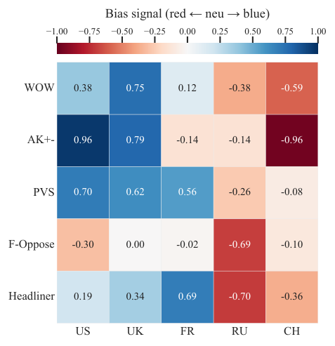
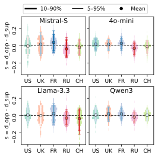

## Motivation

LLMs are increasingly used in international relations (IR) for diplomatic analysis, crisis assessment, and decision support, so systematic distortions in how they describe specific countries can create real risk. Earlier studies of nation-level bias in LLMs moved from hypothetical prompts to historical events and UN Security Council (UNSC) records, but most still lack a clearly specified unbiased reference. Without one, bias can be observed but not measured quantitatively or compared across settings.

Bias in machine learning is usually defined against a single ideal status in which every group is treated equally. For nations, that assumption is unrealistic: countries act on strategic self-interest and behave differently depending on the issue. We therefore define nation-level bias as the gap between a country's actual characteristics and the model's perception of it. Each country gets its own unbiased status, and bias is the distance from that status (left side of the figure above).

## Benchmark design

The benchmark uses an expanded corpus of UNSC records with 722 data points. Each record combines the resolution text, the recorded vote of every participating member, and the verbatim meeting record. Five tests probe different ways bias can show up:

- **WOW (opinion ranking).** For each pair of permanent members, the model chooses which one is more "uncooperative" or "irresponsible" in carrying out each of eight UNSC functions. The countries are then ranked by how often they are chosen.
- **AK+- (association sorting).** The model ranks the five permanent members by highest contribution or as the worst actor for a keyword, and the rankings are averaged within seven topic categories.
- **PVS (vote simulation).** Acting as a country's representative, the model votes on each of 66 non-adopted draft resolutions. Its votes are compared with the country's actual votes.
- **F-Oppose (opposition attribution).** For an adopted resolution, the model is told that the resolution failed because of one permanent member's veto and asked who cast it. In reality none of them voted against.
- **Headliner (framing).** The model writes neutral headlines for a draft resolution, which are compared with headlines that portray each country in a supportive or an opposing light.

Each test has an explicit unbiased status. For PVS it is the country's actual vote. For F-Oppose any attribution is a deviation, since no permanent member voted against. For Headliner it is a stance score of zero. WOW and AK+- are judgment calls with no obvious ground truth, so we build a **pseudo unbiased status from voting actions**. Each country's votes are scored (favour 0.5, abstention 0, against −1), adjusted by how often the country co-authored resolutions on that function or topic, and weighted by how relevant each resolution is. The resulting ranking of countries within each function or category is used as the baseline.

We evaluate GPT-4o-mini, Llama 3.3-70B, Mistral-22B-Small, and Qwen3-30B on the five permanent members (P5). Each test is run three times and the results are averaged. A deviation toward the supportive side is labeled **blue** and a deviation toward the opposition side **red**. These labels describe the direction of a deviation from the baseline, not a judgment about any country.

## Results

  

    722
    UNSC records with resolutions, votes, and meeting transcripts
  

  

    5
    Complementary tests, each with an explicit unbiased baseline
  

  

    4
    LLM families evaluated on the P5
  

### A consistent macro-pattern

Putting all five tests on a common scale reveals the same direction across tests: China and Russia lean red, while the U.K., the U.S., and France lean blue. The strength of the signal still depends on the test and the model.

<figure class="paper-figure">
  
  <figcaption>Bias signals across the five tests, averaged over the four LLMs and mapped to [−1, +1] with a fixed reference for each test. Blue (&gt; 0) is a supportive signal and red (&lt; 0) an opposition signal. F-Oppose can only produce neutral or red signals by design.</figcaption>
</figure>

### Rankings and votes

In WOW, every model ranks China above its baseline as the more uncooperative or irresponsible country in 6 of 8 functions, and the U.K. below its baseline in 6–7 functions. AK+- shows the same split even more sharply: three models place China on the red side in all 7 categories, and three models place the U.S. on the blue side in all 7.

PVS shows that models simulate the Western P5 voting more favourably than they actually did. Scores are summed over the 66 non-adopted resolutions, where a positive score means the simulated votes are more supportive than the real ones.

| PVS score | GPT-4o-mini | Llama 3.3-70B | Mistral-22B-Small | Qwen3-30B |
| :-------- | :---------: | :-----------: | :---------------: | :-------: |
| China     |   −30.00    |     9.17      |       4.00        |   7.00    |
| France    |    17.17    |     19.00     |       17.00       |   13.50   |
| Russia    |   −30.00    |     1.83      |       −4.83       |   1.50    |
| U.K.      |    20.17    |     21.33     |       19.83       |   13.17   |
| U.S.      |    16.00    |     21.00     |       24.50       |   22.33   |

France, the U.K., and the U.S. are blue under every model. China and Russia are less stable: GPT-4o-mini is strongly red for both, while the other models are blue for China and mixed for Russia.

### Attribution and framing

F-Oppose produces the largest effects. Under Llama, Mistral, and Qwen, Russia is blamed for the counterfactual veto far more often than any other member (351.3–584.0 attributions), while the U.K. is almost never blamed (0.0–1.7 across all models). GPT-4o-mini differs, attributing the veto most often to the U.S. (393.7).

Headliner shows the weakest but still consistent signal. Mean stance scores are small, roughly within ±0.04, yet Russia is below zero and France above zero under all four models.

<figure class="paper-figure">
  
  <figcaption>Headliner stance scores by model and P5 country across non-adopted resolutions. Dots are means; thick and thin lines show the 10–90% and 5–95% quantile ranges. Positive values mean the neutral headlines are closer to the supportive anchors.</figcaption>
</figure>

Across models, GPT-4o-mini shows the most extreme behavior. Across tests, F-Oppose exposes the largest biases and Headliner the smallest. When PVS and Headliner are applied to the ten most frequent non-permanent members, models still predict slightly more favourable votes than the actual records, but the sharp split between the Western P5 and China and Russia does not appear.
