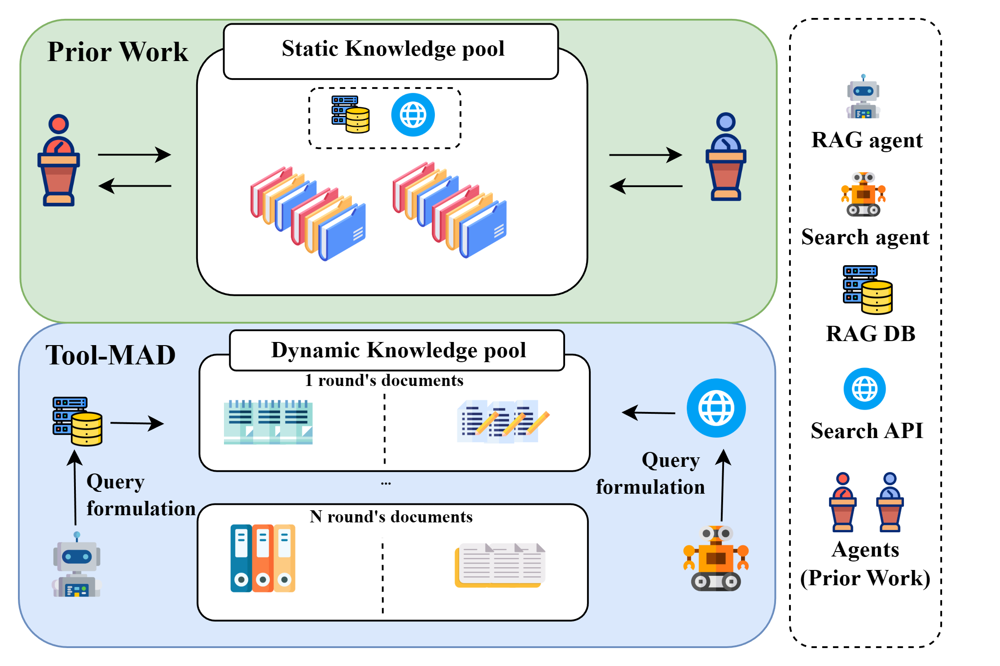

## Motivation

In multi-agent debate (MAD), several LLM agents exchange arguments and critique each other's reasoning. Most debate frameworks, however, rely on the model's internal knowledge or on a fixed set of documents. MADKE adds external evidence, but retrieves it once before the debate starts, so the evidence pool cannot adapt when new claims or information gaps appear during the discussion.

<figure class="paper-figure">
  
  <figcaption>Prior debate frameworks share a static knowledge pool retrieved in advance. In Tool-MAD, each agent formulates its own queries and retrieves new documents every round.</figcaption>
</figure>

Different evidence sources also have complementary strengths: web search offers broad, up-to-date coverage, while RAG retrieves semantically aligned documents from a curated corpus. Tool-MAD grounds each debater in a different source and lets disagreement drive further retrieval.

## Method

Tool-MAD runs a debate between two agents with different tools, followed by a Judge when needed, as shown in the overview figure at the top.

**1. Heterogeneous tools.** The RAG agent retrieves from a Wikipedia corpus indexed in a Milvus vector store, and the Search agent queries the live web through the Tavily Search API. Each returns the top three documents per query.

**2. Adaptive query formulation.** In the first round, each agent builds a query from the claim alone. In later rounds, it rewrites its query using the opponent's previous answer, retrieves new evidence, and updates its response.

**3. Stability score.** Every response is scored each round with two RAGAS metrics: faithfulness (is the answer supported by the retrieved evidence?) and answer relevance (does it address the claim?). The thresholds are 0.7 and 0.8. The debate ends early only when both agents agree and both pass the thresholds.

**4. Judge agent.** If no consensus is reached within three rounds, the Judge decides from the claim, the full debate history, and each agent's average stability score.

## Results

Tool-MAD was evaluated on four fact verification benchmarks (FEVER, FEVEROUS, FAVIQ, AVeriTeC) with 500 sampled claims each, using Exact Match. With GPT-4o-mini as the backbone, it outperforms the single-agent and debate baselines on average, and also outperforms the larger GPT-4o on all four datasets.

  

    +10.0 pp
    Average gain over MAD
  

  

    +3.2 pp
    Average gain over MADKE
  

  

    +12.2 pp
    Over GPT-4o on AVeriTeC
  

| Exact Match (%)            |  FEVER   | FEVEROUS |  FAVIQ   | AVeriTeC | Average  |
| :------------------------- | :------: | :------: | :------: | :------: | :------: |
| GPT-4o                     |   64.2   |   30.6   |   73.4   |   44.8   |   53.3   |
| GPT-4o-mini + MAD          |   61.8   |   61.0   |   63.0   |   44.8   |   57.7   |
| GPT-4o-mini + MADKE        |   65.8   |   63.6   |   73.8   |   54.6   |   64.5   |
| **GPT-4o-mini + Tool-MAD** | **67.8** | **71.6** | **74.2** | **57.0** | **67.7** |

With Llama-3.3-70B as the backbone, Tool-MAD again achieves the highest average (69.2 vs. 58.1 for MADKE).

### Two different tools beat two of the same

On a 200-claim subset, pairing two agents with the same tool (RAG + RAG or Search + Search) outperforms two tool-free agents, but falls short of pairing RAG with Search. Homogeneous agents tend to retrieve overlapping content, while the hybrid pair explores complementary evidence.

| Exact Match (%)   |  FEVER   | FEVEROUS |  FAVIQ   | AVeriTeC |
| :---------------- | :------: | :------: | :------: | :------: |
| Vanilla + Vanilla |   62.0   |   40.0   |   60.0   |   45.0   |
| RAG + RAG         |   67.5   |   60.5   |   68.5   |   56.5   |
| Search + Search   |   67.0   |   60.5   |   68.5   |   55.5   |
| **RAG + Search**  | **73.0** | **71.5** | **77.5** | **62.0** |

### Query formulation and stability score both help

Rewriting queries in response to the opponent improves Exact Match on FEVER (+2.0), FEVEROUS (+2.5), and AVeriTeC (+1.0), and leaves FAVIQ unchanged. Using the stability score to filter responses improves performance on all four datasets, most on FAVIQ (+4.5). Across datasets, correct answers have higher faithfulness and answer relevance than incorrect ones.

### Transfer to medical QA

As a preliminary domain-transfer test, the tools were swapped for biomedical sources: a PubMed-based RAG corpus for MedQA and the OpenAlex scholarly database for PubMedQA. Tool-MAD scores 77.0 on MedQA and 29.0 on PubMedQA, ahead of MAD (58.0, 22.5) and MADKE (74.0, 21.5).
