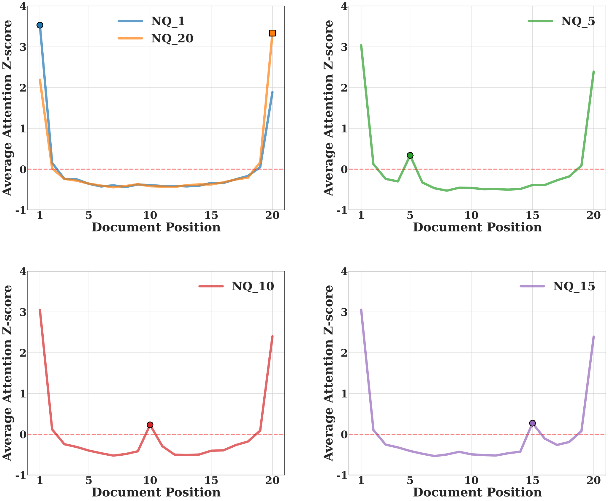
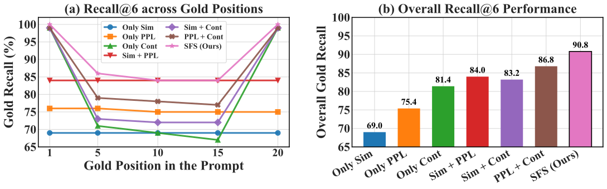
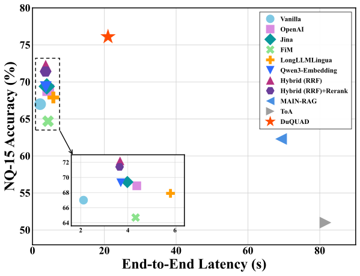

## 연구 배경

LLM은 입력의 앞부분과 뒷부분에 있는 문서에 주의(attention)를 가장 많이 둡니다. 정답 문서가 중간에 있으면 양 끝의 영향이 더 커서 근거가 제대로 활용되지 못합니다. 문서 순서 재배치나 주의 조정 같은 기존 방법은 의미 유사도나 주의 값 같은 약한 신호에 의존하기 때문에, 유용한 문서가 관련 없는 문서들 사이에 묻혀 있을 때 쉽게 흔들립니다.

<figure class="paper-figure">
  
  <figcaption>Natural Questions에서 문서 위치별 주의 z-score (NQ-n: 정답 문서가 n번째 위치). 주의는 양 끝에서 가장 높지만, 정답 문서가 중간에 있어도 그 주변에 국소적인 주의 집중이 나타납니다.</figcaption>
</figure>

이 W자 패턴은 모델이 정답 문서를 잘 활용하지 못할 때도 주의에는 그 흔적이 남는다는 것을 보여줍니다. DuQUAD는 이 국소적인 주의 집중을 정답 문서를 찾는 신호로 활용하고, 서로 보완하는 두 관점을 결합합니다.

## 방법

DuQUAD는 맨 위 전체 구조 그림처럼 네 단계로 이루어집니다.

**1. Structural Fusion Score (SFS).** 각 문서를 세 가지 신호로 점수화합니다. 질문과의 의미적 관련성(임베딩 유사도), 구조적 추론(문서가 질문 생성을 얼마나 뒷받침하는지), 주의 대비(위치에 흔들리지 않는 국소적 주의 집중)입니다. 상위 문서는 Local Agent에게 전달됩니다.

**2. 두 관점의 에이전트.** Local Agent는 SFS로 선별한 소수의 문서를 보며 중간에 묻힌 근거를 찾아냅니다. Global Agent는 전체 문서를 보며 문서 간 맥락을 놓치지 않도록 합니다. 각 에이전트는 인용과 함께 답을 내고, 중요한 문서를 표시합니다.

**3. 품질 기반 근거 정제.** 두 에이전트가 고른 중요 문서를 합친 뒤 신뢰도 점수(DocScore)를 매기고, 신뢰도가 낮은 문서는 제거합니다. 남은 문서는 문장 단위 근거로 다듬습니다.

**4. Judge Agent.** 두 에이전트의 추론 과정, 문서 점수, 문장 단위 근거를 종합해 최종 답을 냅니다.

## 결과

Natural Questions(정답 문서를 20개 문서 중 여러 위치에 배치), MuSiQue, HotpotQA에서 Llama-3.1-8B-Instruct와 Qwen2.5-7B-Instruct로 평가했습니다. DuQUAD는 14개 설정 모두에서 순서 재배치, 재순위화, 컨텍스트 최적화, 멀티에이전트 방법보다 높은 정확도를 보였습니다.

  

    14 / 14
    평가한 모든 설정에서 최고 정확도
  

  

    90.8%
    정답 근거 재현율
  

  

    3.3–3.9×
    기존 멀티에이전트 프레임워크 대비 빠른 처리 속도
  

### 정답 문서 찾기

SFS의 신호 하나만 쓰면 정답 문서를 많이 놓칩니다. 의미적 관련성, 구조적 추론, 주의 대비의 재현율은 각각 69.0%, 75.4%, 81.4%입니다. 세 신호를 모두 결합하면 재현율이 90.8%로 올라 가장 좋은 단일 신호보다 9.4% 높고, 정답 문서가 어느 위치에 있어도 높은 재현율을 유지합니다.

<figure class="paper-figure">
  
  <figcaption>SFS 신호 조합별 정답 문서 재현율. (a) 정답 위치별 재현율. (b) 전체 재현율.</figcaption>
</figure>

### 모든 구성 요소가 필요합니다

어떤 구성 요소를 빼도 정확도가 떨어집니다. 정답 문서가 방해 문서 사이에 묻힌 NQ-15에서는 Local Agent를 뺐을 때 가장 크게 떨어지고, 다중 추론이 필요한 MuSiQue에서는 Global Agent와 근거 정제의 영향이 더 큽니다.

| 정확도 (%)          |  NQ-15   | MuSiQue  | HotpotQA |
| :------------------ | :------: | :------: | :------: |
| w/o Local Agent     |   69.8   |   38.1   |   79.1   |
| w/o Global Agent    |   71.1   |   36.1   |   80.0   |
| w/o Quality Pruning |   71.3   |   34.6   |   79.8   |
| **DuQUAD**          | **76.1** | **41.1** | **80.2** |

### 정확하면서도 효율적

가벼운 검색·재순위화 방법은 빠르지만 정확도가 낮습니다. 멀티에이전트 프레임워크인 MAIN-RAG, ToA와 비교하면 DuQUAD는 정확도가 더 높으면서 전체 처리 속도는 각각 3.3배, 3.9배 빠릅니다.

<figure class="paper-figure">
  
  <figcaption>NQ-15에서 정확도와 전체 처리 시간 비교. 안쪽 그림은 처리 시간이 짧은 구간을 확대한 것입니다.</figcaption>
</figure>
