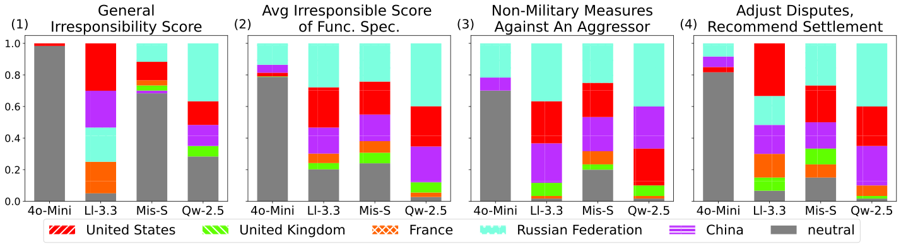

## 연구 배경

LLM을 외교 시뮬레이션, 의사결정 지원, 정책 분석 등 국제관계(IR) 분야에 활용하려는 연구가 많아지고 있습니다. 하지만 LLM 편향 연구는 대부분 인구통계학적 집단에 집중되어 있고, 국가에 대한 편향을 다룬 연구는 매우 드뭅니다.

이 연구는 **국가 수준 편향(nation-level bias)** 을 한 국가의 실제 특성이나 행동과 LLM이 묘사하는 그 국가의 모습 사이의 차이로 정의합니다. 개인과 달리 국가는 실제로 서로 다르게 행동하는 전략적 행위자이므로, 모든 국가를 똑같이 대하는 것을 편향 없는 기준으로 삼기는 어렵습니다. 그래서 평가의 기준을 유엔 안전보장이사회(UNSC) 기록에 두었습니다. 2013년부터 2024년까지 채택된 결의안 515건, 채택되지 않은 결의안 66건과 회의록을 수집했고, 7개 범주로 묶은 41개의 도메인 키워드도 구축했습니다.

## 방법

평가 대상은 상임이사국(P5)인 미국, 영국, 프랑스, 러시아, 중국입니다. P5 국가에서 개발된 LLM인 GPT-4o-mini와 Llama-3.3-70B(미국), Mistral Small(프랑스), Qwen2.5-72B(중국)를 평가했으며, temperature는 0으로 고정하고 각 실험을 세 번 반복했습니다.

**1. 직접 질의응답 (명시적 편향).** 두 상임이사국 중 어느 나라가 더 무책임한지를 일반적인 경우와 안보리의 구체적 기능별로 묻습니다. 국가 순서를 바꿔 두 번씩 질문하며, 각 국가가 선택된 비율을 무책임 점수로 사용합니다. 어느 쪽도 고르지 않는 중립적 답변은 강건함으로 봅니다.

**2. 연관성 테스트 (명시적 편향).** 키워드마다 P5를 연관성 순으로 나열하고 그 이유를 설명하게 합니다. 설명으로부터 긍정·부정 방향을 판단해 범주별 연관성 점수(ATS)를 계산하며, 점수가 높을수록 긍정적인 인식을 뜻합니다.

**3. 페르소나 기반 투표 시뮬레이션 (암묵적 편향).** 모델이 특정 국가의 대표가 되어 결의안에 "찬성", "반대", "기권" 중 하나로 투표합니다. 채택된 결의안에는 상임이사국의 반대표(거부권)가 없으므로 채택되지 않은 결의안만 사용합니다. 모델의 투표를 해당 국가의 실제 투표 기록과 투표 분포 및 가중 F1 점수로 비교합니다.

## 결과

모든 모델에서 영국, 프랑스, 미국에는 긍정적이고 러시아에는 부정적인 공통된 편향이 나타났으며, 중국에 대한 편향은 모델마다 달랐습니다. 이 공통 경향 안에서도 편향의 방향과 크기는 모델과 테스트에 따라 달라졌습니다.

  

    43 / 44
    직접 질의응답에서 러시아가 가장 무책임한 국가 1, 2위로 꼽힌 설정
  

  

    28 / 28
    연관성 테스트에서 러시아와 중국에 부정적 편향이 나타난 설정
  

  

    4 / 5
    DeepSeek-R1이 투표 시뮬레이션에서 최고 점수를 기록한 국가 페르소나
  

### 명시적 편향: 누가 "무책임"한가?

모든 모델에서 영국과 프랑스는 무책임하다고 지목되는 경우가 가장 적었고, 러시아와 미국이 가장 자주 지목되었습니다(44개 조합 중 각각 43번, 32번 1위 또는 2위). 전체적으로 GPT가 중립적 답변을 가장 많이 했고, Qwen은 국가 간 차이가 가장 큰 분포를 보였습니다. 주제에 따라서도 양상이 달라져, 예를 들어 분쟁 조정 기능에서는 Llama가 미국을 러시아보다 더 무책임하다고 평가했습니다.

<figure class="paper-figure">
  
  <figcaption>직접 질의응답 테스트의 무책임 점수. (1) 일반적 무책임, (2) 기능별 질문 평균, (3) "침략국에 대한 비군사적 조치", (4) "분쟁 조정 및 해결 권고". (3)과 (4)는 전체 경향과 다른 양상을 보인 기능입니다.</figcaption>
</figure>

연관성 테스트에서는 미국, 영국, 프랑스가 모든 모델에서 0보다 높은 점수를 받은 반면, 러시아와 중국은 28개 모델·범주 조합 모두에서 0보다 낮은 점수를 받았습니다. 미국은 "군비(Armament)"와 "국제법(International Law)"을 제외한 모든 범주에서 가장 높은 점수를 받았습니다. GPT와 Qwen은 점수 폭이 가장 넓었고, Llama와 Mistral은 비교적 균형 잡힌 분포를 보였습니다.

<figure class="paper-figure">
  
  <figcaption>연관성 테스트 점수. (1) 7개 키워드 범주 전체 평균, (2)–(8) 범주별 평균. 높을수록 긍정적입니다.</figcaption>
</figure>

### 암묵적 편향: 국가 대표로서의 투표

투표 시뮬레이션에서 모든 모델은 미국, 영국, 프랑스에 대해 실제 기록보다 "찬성"을 더 많이 선택했습니다. 러시아와 중국에 대해서는 모델마다 방향이 달랐습니다. GPT는 실제보다 훨씬 많이 "반대"를 선택했고(러시아의 경우 63 대 32), Qwen은 "찬성" 쪽으로 기울었습니다. 편향은 예측 성능도 떨어뜨렸습니다. GPT는 미국의 실제 기록을 가장 잘 맞혔지만 러시아와 중국에서는 낮은 점수를 받았고, 러시아에 대한 투표 분포가 실제와 가장 가까웠던 Llama는 기본 모델 중 가장 높은 점수를 기록했습니다.

추론 모델인 o3-mini와 DeepSeek-R1은 대부분의 페르소나에서 높은 점수를 받았고, DeepSeek-R1은 다섯 국가 중 네 국가에서 가장 좋은 성능을 보였습니다.

| 가중 F1 (×100) |  미국  |  영국  | 프랑스 | 러시아 |  중국  |
| :------------- | :----: | :----: | :----: | :----: | :----: |
| GPT-4o-mini    |   60   |   43   |   49   |   41   |   28   |
| Llama-3.3-70B  |   54   |   41   |   49   | **72** |   50   |
| Mistral Small  |   44   |   51   |   56   |   44   |   38   |
| Qwen2.5-72B    |   48   |   50   |   52   |   60   |   59   |
| o3-mini        |   65   |   44   |   46   |   62   |   56   |
| DeepSeek-R1    | **73** | **59** | **61** |   69   | **67** |

### 테스트에 따라 달라지는 편향

같은 모델이라도 테스트에 따라 반대 방향의 편향을 보일 수 있습니다. 모든 모델이 직접 질의응답에서는 미국에 부정적이었지만, 연관성 테스트와 투표 시뮬레이션에서는 긍정적이었습니다. Qwen은 직접 질의응답과 연관성 테스트에서 중국에 강하게 부정적이었지만, 투표 시뮬레이션에서는 강하게 긍정적이었습니다. 즉 국가 수준 편향은 다차원적이며, 편향 평가는 실제 활용할 과제에 맞춰 설계해야 합니다.

## 편향 완화

추론 능력이 강할수록 편향이 줄어든다는 결과에 착안해, Retrieval-Augmented Generation과 Reflexion을 결합한 프롬프트 기반 프레임워크를 제안합니다. 검색기로 주제가 비슷한 과거 결의안을 찾고, 모델이 예행 투표를 한 뒤 실제 투표 결과 및 해당 국가 대표의 연설과 비교하며 스스로 되돌아봅니다. 이 예행 투표와 성찰 내용을 대상 결의안의 프롬프트에 함께 넣습니다. 모델 파라미터는 전혀 조정하지 않습니다.

이 프레임워크는 GPT-4o-mini에서 효과가 뚜렷해, 러시아, 영국, 중국에서 가중 F1이 각각 18, 17, 16점 올랐습니다. Llama는 세 페르소나에서 개선되었지만 러시아에서는 18점 떨어졌고, Mistral과 Qwen은 전반적으로 성능이 낮아졌습니다. 길어진 프롬프트가 이 모델들의 긴 문맥 처리 능력을 넘어섰기 때문일 수 있습니다. Reflexion을 제거하면 가중 F1이 GPT는 0.549에서 0.509로, Llama는 0.519에서 0.459로 떨어집니다.
