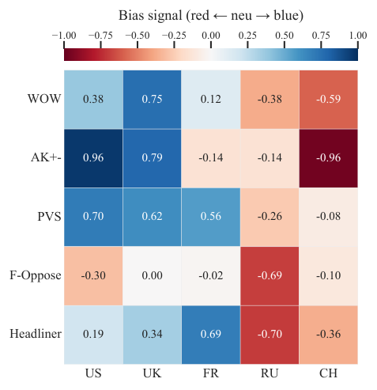
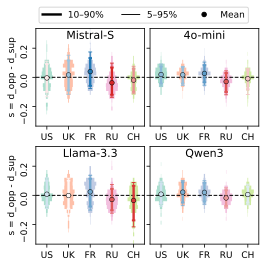

## 연구 배경

LLM은 외교 분석, 위기 평가, 의사결정 지원 등 국제관계(IR) 분야에서 점점 더 많이 쓰이고 있습니다. 그만큼 특정 국가를 묘사하는 방식에 체계적인 왜곡이 있다면 실제 위험으로 이어질 수 있습니다. 기존 연구는 가상의 시나리오에서 역사적 사건, 유엔 안전보장이사회(UNSC) 기록으로 평가 데이터를 발전시켜 왔지만, 대부분 무엇이 편향되지 않은 상태인지를 명확히 정하지 않았습니다. 기준점이 없으면 편향을 관찰할 수는 있어도 정량적으로 측정하거나 설정 간에 비교하기는 어렵습니다.

머신러닝에서 편향은 보통 모든 집단을 똑같이 대하는 하나의 이상적인 상태를 기준으로 정의합니다. 하지만 국가는 전략적 이해관계에 따라 움직이고 사안마다 다르게 행동하므로, 모든 국가가 같다고 가정하는 것은 현실적이지 않습니다. 그래서 이 연구는 국가 단위 편향을 국가의 실제 특성과 모델이 인식하는 모습 사이의 차이로 정의합니다. 국가마다 고유한 비편향 상태가 있고, 그로부터 떨어진 거리가 편향입니다(위 그림의 왼쪽).

## 벤치마크 구성

평가에는 722건으로 확장한 UNSC 기록을 사용합니다. 각 기록에는 결의안 원문, 참여한 모든 이사국의 실제 표결, 회의 속기록이 함께 들어 있습니다. 다섯 가지 테스트는 편향이 드러나는 서로 다른 경로를 살펴봅니다.

- **WOW (의견 순위).** 상임이사국 두 나라를 짝지어, 8가지 UNSC 기능 각각에서 어느 나라가 더 "비협조적"이거나 "무책임"한지 고르게 합니다. 선택된 횟수로 국가 순위를 매깁니다.
- **AK+- (연관 정렬).** 키워드마다 가장 크게 기여한 나라 또는 가장 나쁜 행위자 순으로 상임이사국 다섯 나라를 정렬하게 하고, 7개 주제 범주별로 평균을 냅니다.
- **PVS (표결 시뮬레이션).** 모델이 특정 국가의 대표가 되어 부결된 결의안 초안 66건에 표를 던지고, 이를 그 국가의 실제 표결과 비교합니다.
- **F-Oppose (반대 귀속).** 채택된 결의안을 주고, 상임이사국 한 나라의 거부권 때문에 부결되었다는 가상의 전제를 제시한 뒤 누가 반대했는지 묻습니다. 실제로는 어느 나라도 반대하지 않았습니다.
- **Headliner (프레이밍).** 결의안 초안에 대해 모델이 쓴 중립적인 헤드라인을, 각 국가를 우호적으로 또는 부정적으로 그린 헤드라인과 비교합니다.

테스트마다 명시적인 비편향 상태가 있습니다. PVS는 국가의 실제 표결, F-Oppose는 어떤 상임이사국도 반대하지 않았으므로 귀속 자체가 편차이고, Headliner는 입장 점수 0이 기준입니다. WOW와 AK+-는 판단에 기반한 질문이라 정답을 정하기 어렵기 때문에, **실제 표결 행동에 기반한 유사 비편향 상태**를 만듭니다. 각 국가의 표결에 점수를 주고(찬성 0.5, 기권 0, 반대 −1), 해당 기능이나 주제의 결의안을 얼마나 공동 발의했는지에 따라 조정한 뒤, 결의안별 관련도로 가중합니다. 이렇게 얻은 기능·범주별 국가 순위를 기준으로 삼습니다.

GPT-4o-mini, Llama 3.3-70B, Mistral-22B-Small, Qwen3-30B를 상임이사국 다섯 나라(P5)에 대해 평가했습니다. 각 테스트는 세 번 실행해 평균을 냈습니다. 지지 쪽으로 벗어난 편차는 **blue**, 반대 쪽으로 벗어난 편차는 **red**로 부릅니다. 이 표시는 기준에서 벗어난 방향을 나타낼 뿐, 국가에 대한 가치 판단이 아닙니다.

## 결과

  

    722
    결의안·표결·회의록을 담은 UNSC 기록
  

  

    5
    명시적인 비편향 기준을 갖춘 상호 보완적 테스트
  

  

    4
    P5에 대해 평가한 LLM 계열
  

### 일관된 거시적 패턴

다섯 테스트를 같은 척도로 맞춰 보면 방향이 일관됩니다. 중국과 러시아는 red 쪽으로, 영국·미국·프랑스는 blue 쪽으로 기웁니다. 다만 신호의 세기는 테스트와 모델에 따라 다릅니다.

<figure class="paper-figure">
  
  <figcaption>다섯 테스트의 편향 신호를 테스트별 고정 기준으로 [−1, +1]에 맞추고 네 LLM에 대해 평균한 결과. 파란색(&gt; 0)은 지지 쪽, 빨간색(&lt; 0)은 반대 쪽 신호입니다. F-Oppose는 구조상 중립이나 red 신호만 나옵니다.</figcaption>
</figure>

### 순위와 표결

WOW에서는 모든 모델이 8개 기능 중 6개에서 중국을 기준보다 더 비협조적이거나 무책임한 나라로 꼽고, 영국은 6–7개 기능에서 기준보다 덜 꼽습니다. AK+-에서는 이 차이가 더 뚜렷합니다. 세 모델이 7개 범주 모두에서 중국을 red 쪽에, 또 세 모델이 7개 범주 모두에서 미국을 blue 쪽에 둡니다.

PVS에서는 모델이 서방 상임이사국의 표결을 실제보다 더 우호적으로 예측합니다. 아래 점수는 부결된 결의안 66건에 대해 합산한 값으로, 양수는 시뮬레이션한 표결이 실제보다 더 지지적이라는 뜻입니다.

| PVS 점수 | GPT-4o-mini | Llama 3.3-70B | Mistral-22B-Small | Qwen3-30B |
| :------- | :---------: | :-----------: | :---------------: | :-------: |
| 중국     |   −30.00    |     9.17      |       4.00        |   7.00    |
| 프랑스   |    17.17    |     19.00     |       17.00       |   13.50   |
| 러시아   |   −30.00    |     1.83      |       −4.83       |   1.50    |
| 영국     |    20.17    |     21.33     |       19.83       |   13.17   |
| 미국     |    16.00    |     21.00     |       24.50       |   22.33   |

프랑스, 영국, 미국은 모든 모델에서 blue입니다. 반면 중국과 러시아는 덜 안정적입니다. GPT-4o-mini는 두 나라 모두 강한 red를 보이지만, 나머지 모델은 중국에 대해 blue이고 러시아에 대해서는 엇갈립니다.

### 귀속과 프레이밍

F-Oppose에서 가장 큰 효과가 나타납니다. Llama, Mistral, Qwen은 가상의 거부권을 다른 어떤 나라보다 러시아에 훨씬 많이 돌리고(351.3–584.0회), 영국에는 모든 모델에서 거의 돌리지 않습니다(0.0–1.7회). GPT-4o-mini는 예외적으로 미국에 가장 많이 돌립니다(393.7회).

Headliner의 신호는 가장 약하지만 방향은 일관됩니다. 평균 입장 점수는 대략 ±0.04 안쪽으로 작지만, 네 모델 모두에서 러시아는 0보다 낮고 프랑스는 0보다 높습니다.

<figure class="paper-figure">
  
  <figcaption>부결된 결의안에 대한 모델별·P5 국가별 Headliner 입장 점수. 점은 평균이고, 굵은 선과 얇은 선은 각각 10–90%, 5–95% 분위 범위입니다. 양수는 중립 헤드라인이 우호적 기준 헤드라인에 더 가깝다는 뜻입니다.</figcaption>
</figure>

모델 중에서는 GPT-4o-mini가 가장 극단적인 결과를 보였고, 테스트 중에서는 F-Oppose가 가장 큰 편향을, Headliner가 가장 작은 편향을 드러냈습니다. PVS와 Headliner를 가장 자주 등장한 비상임이사국 10개국에 적용해 보면, 모델은 여전히 실제보다 약간 더 우호적인 표결을 예측하지만 서방 상임이사국과 중국·러시아 사이의 뚜렷한 대비는 나타나지 않습니다.
