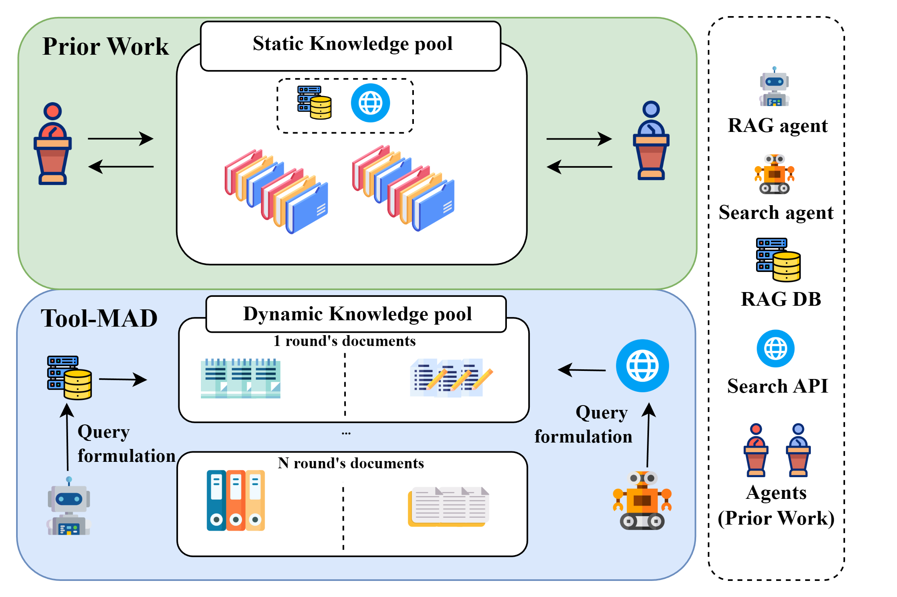

## 연구 배경

멀티에이전트 토론(MAD)에서는 여러 LLM 에이전트가 주장을 주고받으며 서로의 추론을 비판합니다. 그러나 대부분의 토론 프레임워크는 모델 내부 지식이나 고정된 문서 집합에 의존합니다. MADKE는 외부 근거를 도입했지만 토론 시작 전에 한 번만 검색하기 때문에, 토론 중 새로운 주장이나 정보 공백이 생겨도 근거 집합이 바뀌지 않습니다.

<figure class="paper-figure">
  
  <figcaption>기존 토론 프레임워크는 미리 검색한 정적 지식 풀을 함께 사용합니다. Tool-MAD에서는 각 에이전트가 직접 쿼리를 만들고 매 라운드 새로운 문서를 검색합니다.</figcaption>
</figure>

근거 출처마다 강점도 다릅니다. 웹 검색은 넓고 최신의 정보를 제공하고, RAG는 정제된 코퍼스에서 의미적으로 잘 맞는 문서를 가져옵니다. Tool-MAD는 토론자마다 서로 다른 출처에 근거하게 하고, 의견 차이가 추가 검색으로 이어지도록 합니다.

## 방법

Tool-MAD는 맨 위 전체 구조 그림처럼 서로 다른 도구를 가진 두 에이전트가 토론하고, 필요할 때 Judge가 판정합니다.

**1. 서로 다른 도구.** RAG 에이전트는 Milvus 벡터 저장소에 색인한 Wikipedia 코퍼스에서 검색하고, Search 에이전트는 Tavily Search API로 실시간 웹을 검색합니다. 두 도구 모두 쿼리마다 상위 3개 문서를 가져옵니다.

**2. 적응형 쿼리 생성.** 첫 라운드에서는 각 에이전트가 주장만 보고 쿼리를 만듭니다. 이후 라운드에서는 상대의 이전 답변을 반영해 쿼리를 다시 작성하고, 새 근거를 검색해 답변을 갱신합니다.

**3. 안정성 점수.** 매 라운드 모든 답변을 두 가지 RAGAS 지표로 평가합니다. 신뢰성(faithfulness, 답변이 검색된 근거로 뒷받침되는가)과 답변 관련성(answer relevance, 답변이 주장을 다루고 있는가)이며, 기준값은 각각 0.7과 0.8입니다. 두 에이전트의 답이 같고 둘 다 기준을 넘을 때만 토론이 일찍 끝납니다.

**4. Judge 에이전트.** 세 라운드 안에 합의하지 못하면 Judge가 주장, 전체 토론 기록, 각 에이전트의 평균 안정성 점수를 바탕으로 판정합니다.

## 결과

사실 검증 벤치마크 4개(FEVER, FEVEROUS, FAVIQ, AVeriTeC)에서 각각 500개 주장을 샘플링해 Exact Match로 평가했습니다. GPT-4o-mini를 기반 모델로 쓴 Tool-MAD는 평균 기준으로 단일 에이전트 및 토론 방법들보다 높은 성능을 보였고, 4개 데이터셋 모두에서 더 큰 모델인 GPT-4o보다도 높았습니다.

  

    +10.0 pp
    MAD 대비 평균 향상
  

  

    +3.2 pp
    MADKE 대비 평균 향상
  

  

    +12.2 pp
    AVeriTeC에서 GPT-4o 대비 향상
  

| Exact Match (%)            |  FEVER   | FEVEROUS |  FAVIQ   | AVeriTeC |   평균   |
| :------------------------- | :------: | :------: | :------: | :------: | :------: |
| GPT-4o                     |   64.2   |   30.6   |   73.4   |   44.8   |   53.3   |
| GPT-4o-mini + MAD          |   61.8   |   61.0   |   63.0   |   44.8   |   57.7   |
| GPT-4o-mini + MADKE        |   65.8   |   63.6   |   73.8   |   54.6   |   64.5   |
| **GPT-4o-mini + Tool-MAD** | **67.8** | **71.6** | **74.2** | **57.0** | **67.7** |

Llama-3.3-70B를 기반 모델로 썼을 때도 Tool-MAD의 평균 성능이 가장 높았습니다(69.2, MADKE는 58.1).

### 같은 도구 둘보다 다른 도구 둘

200개 주장 부분집합에서, 같은 도구를 쓰는 두 에이전트(RAG + RAG, Search + Search)는 도구가 없는 두 에이전트보다 성능이 높지만, RAG와 Search를 함께 쓰는 조합에는 미치지 못합니다. 같은 도구를 쓰면 겹치는 내용을 검색하기 쉽지만, 서로 다른 도구를 쓰면 상호 보완적인 근거를 탐색할 수 있습니다.

| Exact Match (%)   |  FEVER   | FEVEROUS |  FAVIQ   | AVeriTeC |
| :---------------- | :------: | :------: | :------: | :------: |
| Vanilla + Vanilla |   62.0   |   40.0   |   60.0   |   45.0   |
| RAG + RAG         |   67.5   |   60.5   |   68.5   |   56.5   |
| Search + Search   |   67.0   |   60.5   |   68.5   |   55.5   |
| **RAG + Search**  | **73.0** | **71.5** | **77.5** | **62.0** |

### 쿼리 생성과 안정성 점수 모두 효과가 있습니다

상대의 주장에 맞춰 쿼리를 다시 작성하면 FEVER(+2.0), FEVEROUS(+2.5), AVeriTeC(+1.0)에서 Exact Match가 오르고, FAVIQ에서는 변화가 없습니다. 안정성 점수로 답변을 거르면 4개 데이터셋 모두에서 성능이 오르며, FAVIQ에서 가장 크게(+4.5) 오릅니다. 모든 데이터셋에서 정답인 답변이 오답보다 신뢰성과 답변 관련성 점수가 높았습니다.

### 의료 QA로의 전이

예비적인 도메인 전이 실험으로, 검색 도구를 의생명 분야 출처로 바꿨습니다. MedQA에는 PubMed 기반 RAG 코퍼스를, PubMedQA에는 학술 데이터베이스 OpenAlex를 사용했습니다. Tool-MAD는 MedQA에서 77.0, PubMedQA에서 29.0을 기록해 MAD(58.0, 22.5)와 MADKE(74.0, 21.5)보다 높았습니다.
