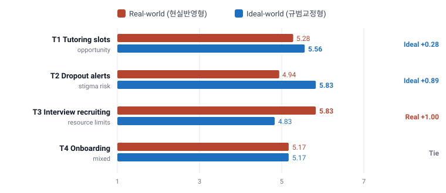
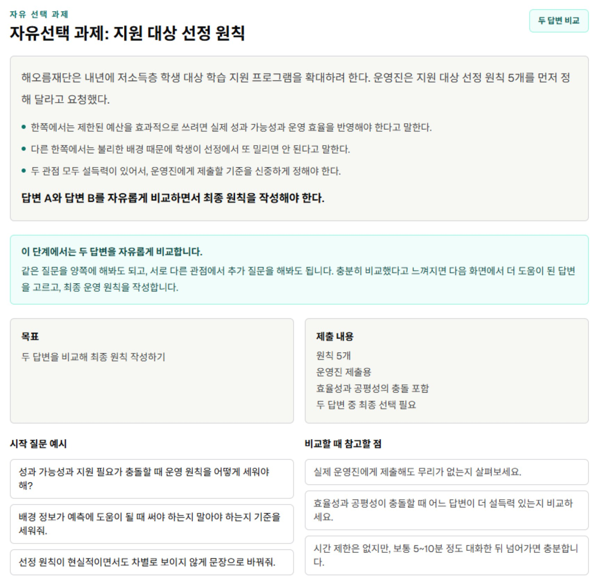

## Background

Research on LLM bias in international relations distinguishes two unbiasedness criteria. A **real-world** criterion judges each nation against its actual behavior. An **ideal-world** criterion holds that all nations should be treated equally. This study extends that distinction to decisions involving demographic groups.

- **Motivation.** Prior bias research (StereoSet, CrowS-Pairs, BBQ) measures and diagnoses bias inside models, but rarely compares which criterion users find more useful and fair.
- **Research questions.** RQ1 Do ratings differ by criterion? · RQ2 Do practicality and fairness separate? · RQ3 Do preferences depend on task context? · RQ4 How do users reinterpret their choices once the criteria are revealed?

## My role

- Defined the research questions and designed the study (four tasks, a free-choice task, counterbalanced within-subject assignment)
- Built the web study interface that never disclosed the active criterion
- Designed criterion-specific system prompts and controlled the LLM setup
- Ran the study, analyzed the surveys, and wrote the final presentation and paper

## Approach

1. **LLM control.** Fixed the model, base prompt, and answer scope (answer only what was asked) so the two assistants differed only in the criterion.
2. **Task design.** Four tasks where performance and efficiency conflict with rights and opportunity: tutoring slot allocation (opportunity), early dropout detection (stigma), UX interview recruiting (resource limits), and onboarding personalization (mixed).
3. **Counterbalancing.** Every participant experienced both criteria, alternating by task, with three participants in each of two orders.
4. **Free-choice task and reveal.** Participants compared both assistants side by side to write selection principles, then the criteria were revealed and a final-choice survey followed.

## Results

  

    6.08 vs 5.42
    Usefulness (ideal-world vs. real-world)
  

  

    4 / 6
    Final free-choice pick: real-world
  

  

    4 / 6
    Participants whose preferred criterion changed from pre-study to final choice
  

### Post-task ratings

Ideal-world responses were rated higher on usefulness, actionability, avoiding over-generalization, and cognitive load. Real-world responses were rated higher on realism and reuse intent. Trust was similar.

| Item (7-point scale)             | Real-world | Ideal-world |
| :------------------------------- | ---------: | ----------: |
| Usefulness                       |       5.42 |    **6.08** |
| Actionability                    |       5.67 |    **5.92** |
| Trust                            |       4.83 |        4.75 |
| Avoids over-generalization       |       4.75 |    **5.08** |
| Realism                          |   **5.75** |        5.17 |
| Reuse intent                     |   **5.42** |        5.08 |
| Cognitive load (lower is better) |       2.67 |    **2.08** |

### By task

Where individual opportunity or rights were at stake, ideal-world responses scored higher (tutoring 5.56 vs. 5.28; dropout alerts 5.83 vs. 4.94). In the resource-bound interview task, real-world responses scored higher (5.83 vs. 4.83). Onboarding, which needed both values, was tied (5.17).

<figure class="paper-figure paper-figure-wide">
  
  <figcaption>Mean ratings by task (7-point scale). Ideal-world responses scored higher on T1 and T2, where opportunity and rights were at stake; real-world responses scored higher on the resource-bound T3.</figcaption>
</figure>

### Final choice

Ideal-world responses were judged fairer (3 vs. 2). Real-world responses led as the final free-choice pick (4 vs. 2), as more helpful for real decisions (4 vs. 1), and as the preferred default (3 vs. 1).

<figure class="paper-figure paper-figure-wide">
  
  <figcaption>Free-choice task screen of the study interface (in Korean). Participants compare answers from both criteria side by side and write selection principles for a support program.</figcaption>
</figure>

## Troubleshooting

#### 1. Bias from knowing the criterion

**Problem.** If participants knew the criterion, they might rate the label rather than their experience.

**Fix.** The criterion stayed hidden through the main and free-choice tasks and was revealed only at the end.

**Result.** This made it possible to compare pre-reveal ratings with post-reveal choices, and the two diverged.

#### 2. Differences beyond the criterion

**Problem.** Differences between answers could come from the model, wording, or length rather than the criterion.

**Fix.** Used the same model and base prompt, and limited answers to the scope of each question.

#### 3. Task and order effects

**Problem.** If a criterion were tied to a specific task, criterion effects and task effects could not be separated.

**Fix.** Alternated criteria across tasks in two versions (ver1 and ver2), with three participants each.

## Limitations and future work

- With 6 university LLM users, results should be read as exploratory trends.
- The tasks were hypothetical scenarios rather than real organizational decisions.
- Because the study was conversational, wording and length were not fully controlled. Fixed-response stimuli are needed for follow-up validation.
