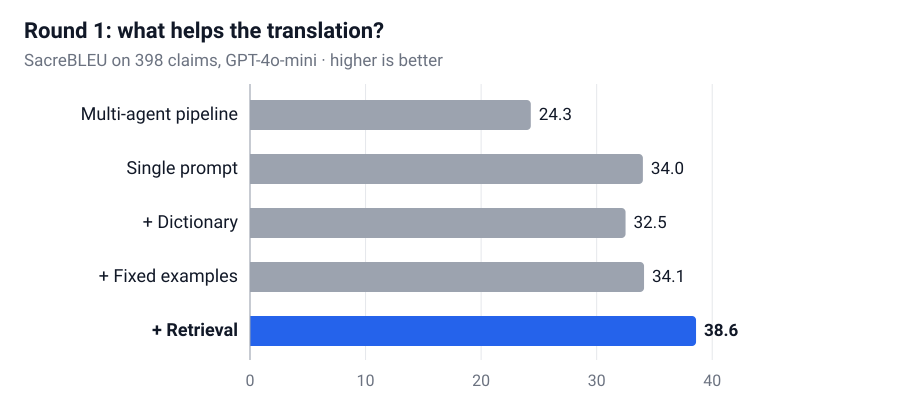

## Background

A patent claim defines the legal scope of an invention. A US claim must follow USPTO drafting conventions, such as a single sentence and consistent references to earlier elements, so the task is closer to drafting than word-for-word translation.

- **Data.** 403 pairs of Korean claims and the English claims actually filed in the US, provided by Hyundai Rotem. 398 were used for testing.
- **Starting point.** With the prompt Hyundai Rotem was using, about 40% of claims scored 30 or below in SacreBLEU. The errors fell into three types: wrong technical terms, wording that didn't read like a patent claim, and cases where the US claim had been strategically redrafted.

## My role

- Led ANDLab's work on the project, from experiment design to delivery to the client.
- Designed and ran all experiments: 8 configurations in the first round, then a structured prompt compared across models.
- Built the retrieval pipeline (Milvus, bge-m3) and the evaluation pipeline (SacreBLEU, PatClaimEval).
- Analyzed errors, presented the results at client meetings, and delivered a claim-by-claim result table.

## Approach

**Round 1: what actually helps?** Using GPT-4o-mini, I compared a three-step multi-agent pipeline (interpret → translate → polish style) against a single prompt. I then added three kinds of help to each: terminology dictionary hints, fixed example claims, and retrieval of the five most similar claim pairs.

**Round 2: a better prompt.** I rewrote the prompt into a structured version with explicit US drafting rules, combined it with retrieval, and compared GPT-4o-mini and Gemini 2.5 Flash.

**Evaluation.** SacreBLEU measures word overlap with the filed claim, and PatClaimEval, a model trained to judge patent claim quality, checks whether the claim is right as a patent claim. I used both because BLEU alone can be misleading (see Troubleshooting).

## Results

  

    34.0 → 38.6
    SacreBLEU with retrieval (round 1)
  

  

    38.8 → 42.7
    SacreBLEU with structured prompt + retrieval (round 2)
  

  

    70%
    Claims improved in round 2
  

### Round 1: retrieval helps, more agents don't

<figure class="paper-figure">
  
  <figcaption>Round 1 with GPT-4o-mini. The three "+" rows add one kind of help to the single prompt. Only retrieval (blue) clearly helped.</figcaption>
</figure>

| SacreBLEU (398 claims) | Plain | + Dictionary | + Fixed examples | + Retrieval |
| :--------------------- | ----: | -----------: | ---------------: | ----------: |
| Multi-agent pipeline   |  24.3 |         24.3 |             24.4 |           – |
| Single prompt          |  34.0 |         32.5 |             34.1 |    **38.6** |

### Round 2: structured prompt

| 398 claims                                | SacreBLEU | PatClaimEval |
| :---------------------------------------- | --------: | -----------: |
| Baseline prompt (GPT-4o-mini)             |      38.8 |         69.3 |
| Structured + retrieval (GPT-4o-mini)      |      42.7 |         70.2 |
| Structured + retrieval (Gemini 2.5 Flash) |  **43.3** |     **71.1** |

280 of 398 claims (70%) improved over the baseline prompt.

## Troubleshooting

#### 1. The multi-agent pipeline scored 10 points lower

**Problem.** Splitting the work into interpret → translate → polish agents scored 24.3, about 10 points below a single prompt (34.0).

**Cause.** Each step was a separate call, so context was lost between steps. The final style step no longer saw how the first step had interpreted the claim's scope.

**Fix.** Moved to a single, structured prompt that keeps interpretation, translation, and drafting rules together.

**Result.** The single prompt became the base for every later improvement, reaching 42.7 in round 2.

#### 2. The terminology dictionary made results worse

**Problem.** Adding hints from a general Korean–English term dictionary (about 850K entries) lowered SacreBLEU from 34.0 to 32.5.

**Cause.** In a later 60-claim ablation, the dictionary's own contribution stayed small; the limits were retrieval quality and the model itself.

**Fix.** Dropped dictionary hints from the main pipeline and put the effort into retrieving better examples.

**Result.** Retrieval alone gave +4.6 points, the largest single gain.

#### 3. BLEU missed a critical error

**Problem.** In one claim "cathode" was translated as "anode", which reverses the meaning, yet BLEU was still 62.8.

**Cause.** BLEU only counts word overlap, so one wrong word barely moves it, while a valid synonym can cost many points.

**Fix.** Added PatClaimEval and compared the two metrics on every claim.

**Result.** PatClaimEval scored that claim low (0.52). Results were reported with both metrics.

#### 4. Retrieval sometimes pulled the wrong wording

**Problem.** In the worst case SacreBLEU fell from 73.8 to 49.3 after adding retrieval.

**Cause.** A retrieved example used "refrigeration unit" where the claim needed "refrigerator", and the model copied it. Other models (Claude, Gemini) dropped on this claim too.

**Fix.** Proposed a confidence gate that skips retrieval when the plain output already scores well.

**Result.** Proposed to the client as a next step; not yet implemented.

## Limitations and next steps

- The reference is the claim actually filed in the US, which was sometimes strategically redrafted. Even a perfect translation can't match those claims exactly.
- Retrieval searched the same 403-claim pool (excluding the claim itself). A larger, separate corpus is needed to rule out overlap between similar claims.
- A second phase (choosing examples by patent classification, and fine-tuning once 2,000+ pairs are available) was proposed but depended on more data from the client.
