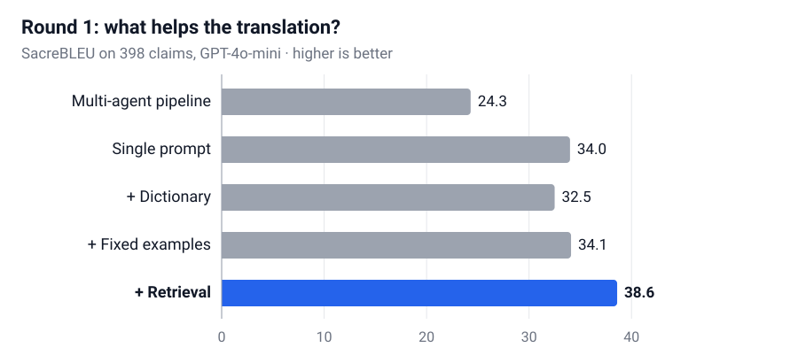

## Background

A patent claim defines the legal scope of an invention. A US claim must follow USPTO drafting conventions, such as a single sentence and consistent references to earlier elements, so the task is closer to drafting than word-for-word translation.

- **Data.** 403 pairs of Korean claims and the English claims actually filed in the US, provided by Hyundai Rotem. 398 were used for testing.
- **Starting point.** With the prompt Hyundai Rotem was using, about 40% of claims scored 30 or below in SacreBLEU. The errors fell into three types: wrong technical terms, wording that didn't read like a patent claim, and cases where the US claim had been strategically redrafted.

## My role

- Led ANDLab's work on the project, from experiment design to delivery to the client.
- Designed and ran all experiments: 8 configurations in the first round, then a second round comparing prompts and models with near-duplicates excluded.
- Built the retrieval pipeline (Milvus, bge-m3) and the evaluation pipeline (SacreBLEU, PatClaimEval).
- Analyzed errors, presented the results at client meetings, and delivered a claim-by-claim result table.

## Approach

**Round 1: what actually helps?** Using GPT-4o-mini, I compared a three-step multi-agent pipeline (interpret → translate → polish style) against a single prompt. I then added three kinds of help to each: terminology dictionary hints, fixed example claims, and retrieval of the five most similar claim pairs.

**Round 2: does it hold up, and can it go further?** I re-scored every output with one scorer and re-ran retrieval with near-duplicate claims excluded. On that setup I compared a structured prompt with explicit US drafting rules and larger models (GPT-4.1-mini, GPT-4.1).

**Evaluation.** SacreBLEU measures word overlap with the filed claim, and PatClaimEval, a model trained to judge patent claim quality, checks whether the claim is right as a patent claim. I used both because BLEU alone can be misleading (see Troubleshooting).

## Results

  

    35.4 → 37.9
    SacreBLEU with retrieval (near-duplicates excluded)
  

  

    0.661 → 0.676
    PatClaimEval with retrieval
  

  

    41.3 · 0.660
    GPT-4.1-mini + retrieval: higher overlap, no quality gain
  

### Round 1: retrieval helps, more agents don't

<figure class="paper-figure paper-figure-wide">
  
  <figcaption>Round 1 with GPT-4o-mini. The three "+" rows add one kind of help to the single prompt. Only retrieval (blue) clearly helped.</figcaption>
</figure>

| SacreBLEU (398 claims) | Plain | + Dictionary | + Fixed examples | + Retrieval |
| :--------------------- | ----: | -----------: | ---------------: | ----------: |
| Multi-agent pipeline   |  24.3 |         24.3 |             24.4 |           – |
| Single prompt          |  34.0 |         32.5 |             34.1 |    **38.6** |

Round-1 scores as reported to the client. Round 2 re-scores everything with one scorer, so the same single prompt reads 35.4 there.

### Round 2: prompts and models, near-duplicates excluded

| 398 claims                                  | SacreBLEU | PatClaimEval |
| :------------------------------------------ | --------: | -----------: |
| GPT-4o-mini, no retrieval                   |      35.4 |        0.661 |
| GPT-4o-mini + retrieval                     |      37.9 |    **0.676** |
| GPT-4o-mini + structured prompt + retrieval |      36.5 |        0.653 |
| GPT-4.1-mini, no retrieval                  |      39.4 |        0.654 |
| GPT-4.1-mini + retrieval                    |      41.3 |        0.660 |
| GPT-4.1 + retrieval                         |  **41.8** |        0.663 |

Retrieval rows exclude claims with the same title and any claim with similarity ≥ 0.85. Within the same model, retrieval raised SacreBLEU (GPT-4.1-mini: +1.9, 95% CI +1.2 to +2.6). GPT-4o-mini with retrieval is the only setup that clearly improved both metrics, and it is also the cheapest, so it is the recommended setup.

## Troubleshooting

#### 1. The multi-agent pipeline scored 10 points lower

**Problem.** Splitting the work into interpret → translate → polish agents scored 24.3, about 10 points below a single prompt (34.0).

**Cause.** Each step was a separate call, so context was lost between steps. The final style step no longer saw how the first step had interpreted the claim's scope.

**Fix.** Moved to a single prompt that keeps interpretation, translation, and drafting rules together.

**Result.** The single prompt became the base for every later experiment.

#### 2. The terminology dictionary made results worse

**Problem.** Adding hints from a general Korean–English term dictionary (about 850K entries) lowered SacreBLEU from 34.0 to 32.5.

**Cause.** In a later 60-claim ablation, the dictionary's own contribution stayed small; the limits were retrieval quality and the model itself.

**Fix.** Dropped dictionary hints from the main pipeline and put the effort into retrieving better examples.

**Result.** Retrieval alone gave +4.6 points, the largest single gain in round 1.

#### 3. BLEU missed a critical error

**Problem.** In one claim "cathode" was translated as "anode", which reverses the meaning, yet BLEU was still 62.8.

**Cause.** BLEU only counts word overlap, so one wrong word barely moves it, while a valid synonym can cost many points.

**Fix.** Added PatClaimEval and compared the two metrics on every claim.

**Result.** PatClaimEval scored that claim low (0.52). Results were reported with both metrics.

#### 4. Retrieval sometimes pulled the wrong wording

**Problem.** In the worst case SacreBLEU fell from 73.8 to 49.3 after adding retrieval.

**Cause.** A retrieved example used "refrigeration unit" where the claim needed "refrigerator", and the model copied it. Other models (Claude, Gemini) dropped on this claim too.

**Fix.** Tested a gate that skips retrieval when the best retrieved example is not similar enough to the claim. The decision uses only that similarity, never the reference.

**Result.** It didn't work. At a 0.70 threshold, large drops (over 10 points) went from 6 claims to 3, but the average fell from 38.6 to 37.8, because even less similar examples help on average. Similarity alone can't tell when retrieval will hurt.

#### 5. Was retrieval just copying near-identical claims?

**Problem.** Retrieval searched the same 403 claims, so a near-identical claim from the same patent family could hand the model the answer.

**Cause.** 59 claims had retrieved a claim with the same title, and the gain was largest when the retrieved claim was very similar (+9.4 points for the 46 most similar cases).

**Fix.** Re-ran retrieval excluding claims with the same title and any claim with similarity ≥ 0.85, and re-ran the original setting once more to measure run-to-run noise.

**Result.** SacreBLEU 37.9, against 38.9 for the original rule (run-to-run difference 0.2) and 35.4 without retrieval. 64% of claims still improved, and PatClaimEval stayed the same (0.676 vs 0.677). About 1 point of the gain came from near-duplicates; the rest holds.

#### 6. The structured prompt's gain didn't hold up

**Problem.** In round 2 a structured prompt with explicit US drafting rules had looked about 4 points better than the baseline prompt.

**Cause.** That gain could not be reproduced. When the saved round-2 outputs were re-scored with the same scorer as everything else, they scored 38.3–38.5, about the same as the baseline prompt with retrieval.

**Fix.** Re-ran both prompts with the same retrieval, the same model, and the same scorer.

**Result.** The structured prompt was worse on both metrics (SacreBLEU 36.5 vs 37.9, PatClaimEval 0.653 vs 0.676), so I kept the simpler prompt.

#### 7. A larger model raised BLEU but not claim quality

**Problem.** Switching to GPT-4.1-mini raised SacreBLEU from 37.9 to 41.3, but PatClaimEval did not rise (0.660 vs 0.676).

**Cause.** The larger models' wording was closer to the filed claims, but the quality model did not rate them as better claims. GPT-4.1 was not clearly better than GPT-4.1-mini either (+0.5 SacreBLEU, 95% CI −0.3 to +1.2).

**Fix.** Reported both metrics side by side instead of picking the setup with the highest BLEU.

**Result.** Recommended GPT-4o-mini with retrieval, the only setup that improved both metrics and the cheapest. Which metric to trust when they disagree needs review by patent attorneys.

## Limitations and next steps

- The reference is the claim actually filed in the US, which was sometimes strategically redrafted. Even a perfect translation can't match those claims exactly.
- Near-duplicates were excluded by title and similarity. Claims from the same patent family with different titles can't be identified without family data, so a separate corpus would still be the cleanest test.
- SacreBLEU and PatClaimEval disagreed on the larger models. A small review by patent attorneys would show which one tracks real claim quality.
- A second phase (choosing examples by patent classification, and fine-tuning once 2,000+ pairs are available) was proposed but depended on more data from the client.
