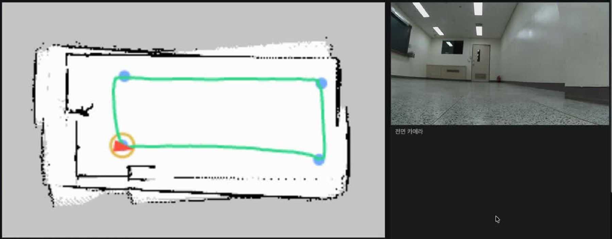

## Background

Hyundai Rotem is exploring quadruped robots to take inspection photos in areas of railway vehicle maintenance that are hard for people to reach. A worker gives a command such as "go to point A and take a photo" from a mobile app, and the robot moves there, takes the photo, and returns the result.

- **Constraints.** No network connectivity. On-site data and site visits were not available for security reasons, so development is based on an indoor test space in the lab.
- **Priority.** First complete the full flow (voice or text command → movement → photo → result check) within six months, then refine shooting position and framing.

## My role

- SLAM and autonomous navigation: mapping, localization, waypoint registration, waypoint navigation, and arrival handling
- Measured the Go2's motion characteristics, compensated velocity commands, and resolved navigation issues found in robot tests
- Main client contact for the lab (scope questions, meeting materials, and minutes)

## Approach

1. **Mapping.** Built a map of the test space with an added XT16 LiDAR and set a reference position as the origin.
2. **Localization and waypoint registration.** Estimated the robot pose with AMCL and saved photo points to the map with IDs and names.
3. **Waypoint navigation.** Planned paths with Nav2; motion commands reach the robot only through the bridge.
4. **Arrival handling.** If heading error exceeds 3°, the robot corrects it with short turns (up to 4) and adjusts posture, and takes a photo only once arrival is confirmed.
5. **Verification.** Combined automated tests of each stage without the robot and runs on the real robot.

## Results

  

    1 cm · 0.3°
    Start-pose initialization error (target 10 cm · 5°)
  

  

    8 / 8
    Arrivals at saved waypoints (5 waypoints registered)
  

  

    176
    Automated tests passed
  

<figure class="paper-figure paper-figure-wide">
  
  <figcaption>Waypoint navigation in the indoor test space. The actual trajectory (green) and registered waypoints (blue) are shown on the SLAM map built for the project; the right panel is the robot's front camera.</figcaption>
</figure>

The full waypoint flow, from start-pose initialization through waypoint registration, autonomous navigation, and automatic photo capture on arrival, was confirmed on the real robot. At the team level, emergency-stop keyword spotting ("정지" and "그만", 3.4% false alarm rate), a small command-interpretation model (HyperCLOVAX 0.5B, 351 MiB), and text-command navigation and capture were also implemented, reaching the stage where a text command in the app drives the robot to a waypoint and takes a photo.

## Troubleshooting

#### 1. No SLAM packages on the robot computer

**Problem.** The robot computer (Jetson) had no SLAM or scan-conversion packages, and the XT16 vendor SLAM could not be used because of a license check.

**Cause.** The robot runs ROS 2 Foxy, so recent open-source packages could not be installed as is.

**Fix.** Implemented the required functions as Python nodes for Foxy, referencing recent open-source implementations.

**Result.** The full waypoint flow, from mapping to arrival handling, runs on the robot.

#### 2. Circling near the goal and stopping early

**Problem.** The robot circled near the goal for about 25 seconds, and stopped 1.4 m short of the goal.

**Cause.** Nav2's heading alignment did not suit the Go2's turning behavior, and including live scans in global planning let a single reflection block the path.

**Fix.** Moved heading alignment from Nav2 to the bridge, removed live scans from global planning, and disabled automatic recovery behaviors.

**Result.** All 8 waypoint runs arrived.

#### 3. Slow commands not executed

**Problem.** A 0.2 m/s command produced only about 0.06 m/s of actual motion, and slow rotation commands were not executed properly.

**Cause.** The Go2's actual motion drops sharply below a certain command speed.

**Fix.** Based on measurements, raised 0.05–0.25 m/s commands to 0.25 m/s and rotations below 0.6 rad/s to 0.6 rad/s, and capped speed at 0.4 m/s and 0.8 rad/s.

**Result.** Waypoint navigation runs without stalls or delays at low speed.

#### 4. CPU overload from LiDAR processing

**Problem.** The LiDAR processing node reached 480% CPU.

**Cause.** No limit on processing threads, so it monopolized Jetson resources.

**Fix.** Limited the number of processing threads.

## Current work and next steps

- Quantitative checks such as repeat arrival accuracy (target 10 cm · 3°) and stop time per stop method are in progress.
- At the client's request, work is under way on marker-free (no AprilTag) vision-based framing correction, photo-quality checks, and robustness to environmental change.
- All tests used an indoor test space; deployment requires re-validation under real site conditions.
