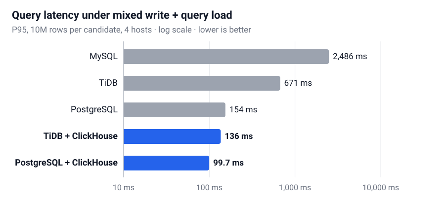

## Background

A railway control (CBTC) system writes a constant stream of train states and events, and at the same time needs fast analytic queries for monitoring and AI models. It ran on a commercial distributed database inside a closed, on-premises network, and Hyundai Rotem wanted to know whether an open-source setup could replace it.

- **No real data.** Operational data could not leave the client. Only a column specification (about 45 tables and 600 columns) was available.
- **Client targets.** Analytic queries at P95 ≤ 50 ms and P99 ≤ 100 ms, and a stable 12-hour run. The client also asked for duplicate handling, data freshness, failure recovery, and MySQL compatibility.

## My role

- Led ANDLab's side of the project and was the main contact with the client. I presented results at every meeting from March to August and wrote the final handover.
- Built the synthetic data generator.
- Designed and ran all database benchmarks and the end-to-end pipeline tests.
- Found the bottlenecks and implemented the optimizations, including batched writes across workers.

## Approach

**1. Generate realistic data.** I built a generator that reads the column specification and infers a rule for each column (value lists, ranges, formats). Master tables are generated first so that every reference between tables stays valid. Train states change over time with per-column probabilities, and events cluster around rush hours.

**2. Compare six candidates.** MySQL, PostgreSQL, TiDB, ClickHouse, and the two combinations TiDB + ClickHouse and PostgreSQL + ClickHouse. Each was tested on loading speed, mixed write-and-query load, failover, and replay of duplicate data.

**3. Validate the whole pipeline.** Kafka (73 topics) → processing workers → database → ClickHouse → Parquet → mock AI server, on two servers and two PCs, at up to 1,000 messages per second.

**4. Optimize and run for 12 hours.** I measured where time was spent, fixed the bottlenecks one by one, and ran the final setup for 12 hours.

## Results

  

    293M rows
    Synthetic data across 44 tables, all references valid
  

  

    219.9 → 18.3 ms
    Analytic query P95 after optimization
  

  

    24.57M
    Records processed in 12 hours with no loss
  

### Single databases can't do both jobs

With 10M rows per candidate on four hosts, every single database slowed down sharply when it had to handle writes and analytic queries at the same time. Adding ClickHouse for analytics kept query latency low.

<figure class="paper-figure paper-figure-wide">
  
  <figcaption>Query P95 while writes and analytic queries run at the same time. Setups with ClickHouse (blue) stay near 100 ms; MySQL alone takes about 2.5 seconds. Log scale.</figcaption>
</figure>

| Candidate       | Load (rows/s) | Mixed load, query P95 | Long run, query P99 |
| :-------------- | ------------: | --------------------: | ------------------: |
| MySQL           |        28,817 |              2,486 ms |           11,348 ms |
| TiDB            |        10,420 |                671 ms |              714 ms |
| PostgreSQL      |        33,484 |                154 ms |              308 ms |
| TiDB + CH       |        27,067 |                136 ms |         **66.2 ms** |
| PostgreSQL + CH |        33,059 |           **99.7 ms** |              112 ms |

### 12-hour run

The final setup processed all 24.57M records with no restarts and no write failures. Row counts and checksums matched between TiDB and ClickHouse, and query latency was P95 26.46 ms and P99 77.01 ms, within the client's targets.

**Recommendation delivered to the client:** TiDB + ClickHouse. TiDB speaks the MySQL protocol, so existing code needs few changes, and it scales by adding nodes. PostgreSQL + ClickHouse also passed and was documented as an alternative.

## Troubleshooting

#### 1. Analytic queries were 4× over the target

**Problem.** Under load, analytic query P95 was 219.9 ms against a 50 ms target.

**Cause.** Every query recomputed its aggregates over the full message history in ClickHouse, so it got slower as data grew.

**Fix.** Kept a small summary table per Kafka topic (at most 73 rows) that is updated as data arrives, and pointed the queries at it.

**Result.** Query P95 fell to **18.3 ms**.

#### 2. Adding workers didn't reduce Kafka backlog

**Problem.** Raising the number of processing workers from 1 to 16 did not stop messages from piling up; peak backlog got worse in 3 of 6 load conditions.

**Cause.** I tested five variants in 64-minute pilots and found the backlog depended on how many rows went into each database write, not on the number of workers. Each worker was writing only about 8 rows at a time. Splitting read and write threads made writes 1.9× slower, so I dropped that idea.

**Fix.** Collected rows across workers into shared batches (20 workers → 4, batches of 100 rows, at most 400 ms wait).

**Result.** Database write calls dropped **14.3×** and peak backlog fell from 11,894 to 1,406 messages (**8.5×**). The trade-off was slightly higher backlog in normal operation (median 93 → 194).

#### 3. The first 12-hour run crashed

**Problem.** In the first 12-hour run a storage node restarted after running out of memory, and the summary table stopped updating for about 12 hours.

**Cause.** Storage cache and memory had no upper limits, automatic statistics collection added load, and the sync into ClickHouse had no cap on its work per cycle.

**Fix.** Set memory limits on the storage nodes, turned off automatic statistics, and capped each ClickHouse sync at 5 seconds and 20 batches.

**Result.** Zero restarts in the rerun, the longest gap between summary updates dropped to 99 seconds, and server memory P95 fell from 98.7% to 77.5%.

## Limitations and next steps

- Everything was validated on synthetic data and lab hardware. Moving to production needs another round of measurement with real data and equipment.
- The remaining peak backlog of 1,406 messages is still above our internal goal of 1,000.
- Some operational checks, such as file transfer to the storage server and failover of whole machines, could not be tested in the lab and were handed over as open items.
