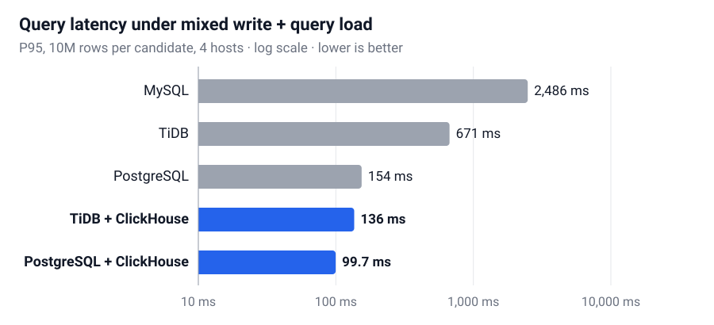

## Background

A railway control (CBTC) system continuously stores train states and events while serving fast analytic queries for control screens and AI models. The system ran on a commercial distributed database in a closed, on-premises network, and Hyundai Rotem requested a validation of whether an open-source setup could replace it.

- **Data constraint.** Operational data could not leave the client; only a column specification (about 45 tables and 600 columns) was provided.
- **Client criteria.** Analytic query P95 ≤ 50 ms and P99 ≤ 100 ms, and a stable 12-hour run. Additional requirements covered duplicate handling, data freshness, failure recovery, and MySQL compatibility.

## My role

- Project lead and main client contact (presented at every meeting from March to August; wrote the final handover document)
- Developed the synthetic data generator and consistency validator based on the column specification
- Designed and ran the database benchmarks and end-to-end pipeline validation
- Bottleneck analysis and performance optimization, including shared batch writes

## Approach

1. **Synthetic data generator.** Since operational data could not leave the client, built a three-stage generator (master → operation plans → states and events) from the column specification (45 tables). Types, ranges, and code values from the specification are applied, and under-specified columns are filled using operating-scenario assumptions (fleet size, service hours, rush-hour peaks). Train states evolve as time series with per-column change probabilities, events are weighted toward peak hours, and a validator checks referential integrity, time ordering, peak distribution, and location–object consistency.
2. **Database candidate comparison.** Compared six setups (MySQL, PostgreSQL, TiDB, ClickHouse, TiDB + ClickHouse, PostgreSQL + ClickHouse) on load throughput, mixed write-and-query load, failover, and duplicate replay.
3. **End-to-end pipeline validation.** Database benchmarks alone could not establish operational fitness, so the scope was extended to the full pipeline at the client's request: Kafka (73 topics) → processing workers → database → ClickHouse → Parquet → mock AI server, on two servers and two PCs, at up to 1,000 messages per second.
4. **Optimization and long-run stability.** Identified bottlenecks by measuring per-stage processing time, resolved them, and ran the final setup continuously for 12 hours.

## Results

  

    293M rows
    Synthetic data (44 tables, 100% referential integrity)
  

  

    219.9 → 18.3 ms
    Analytic query P95 (summary tables)
  

  

    24.57M
    Records in a 12-hour run with no loss
  

### Candidate comparison: limits of a single database under mixed load

With 10M rows per candidate on four hosts, single databases showed a sharp rise in query latency when handling writes and analytic queries together. Combinations that offload analytics to ClickHouse kept query latency low.

<figure class="paper-figure paper-figure-wide">
  
  <figcaption>Query P95 under concurrent writes and analytic queries (log scale). ClickHouse combinations (blue) stay near 100 ms; MySQL alone reaches about 2.5 seconds.</figcaption>
</figure>

| Candidate       | Load (rows/s) | Mixed load, query P95 | Long run, query P99 |
| :-------------- | ------------: | --------------------: | ------------------: |
| MySQL           |        28,817 |              2,486 ms |           11,348 ms |
| TiDB            |        10,420 |                671 ms |              714 ms |
| PostgreSQL      |        33,484 |                154 ms |              308 ms |
| TiDB + CH       |        27,067 |                136 ms |         **66.2 ms** |
| PostgreSQL + CH |        33,059 |           **99.7 ms** |              112 ms |

### Failure and distributed-environment validation

Each candidate was deployed as a cluster across four physical servers and tested under node failures and server failover.

- **Node failure.** With one TiDB storage node paused for 30 seconds, all 2,450 writes and 214 reads completed without failure.
- **Failover.** Across failures of the TiDB storage and SQL layers, PostgreSQL and MySQL primary/replica servers, and ClickHouse replicas, every candidate recorded zero failed writes or reads. However, write P99 rose to 23–30 seconds during primary-server and gateway failures.
- **Recovery under load.** All 14 failure-recovery tests run during the full pipeline (6 in June, 8 in July) recovered within 30.6–37.6 seconds, and 10/50/100% partial cutover and rollback produced no lost or duplicate records.
- **Cost of distribution.** TiDB load throughput on four servers was 10,420 rows/s, about one third of a single server (32,902 rows/s). The gap is attributed to cross-server replication consensus (Raft) and should be factored into production capacity planning.
- **Final cluster.** TiDB (3 storage nodes, 3 PD, 1 SQL node) + ClickHouse + Redpanda (Kafka-compatible).

### End-to-end pipeline validation

In 42 runs comparing the top two combinations (TiDB + CH, PostgreSQL + CH) on identical input, all data consistency, ordering, and replay checks passed, and all 8 failure-recovery tests under load recovered within 30.6–37.6 seconds. With median query P99 of 105.8 ms for TiDB + CH versus 129.4 ms for PostgreSQL + CH, TiDB + CH received a conditional recommendation and was taken forward for optimization.

### 12-hour continuous run

The final setup processed all 24.57M records with no service restarts and no write failures. Row counts and checksums matched between TiDB and ClickHouse, and query latency under continuous writes was P95 26.46 ms and P99 77.01 ms, within the client's criteria.

**Final recommendation:** TiDB + ClickHouse. TiDB's MySQL protocol compatibility keeps code changes small, and it scales horizontally by adding nodes. PostgreSQL + ClickHouse was documented as an alternative that also met the performance criteria.

## Troubleshooting

#### 1. Analytic query latency over target

**Problem.** Under load, analytic query P95 was 219.9 ms, more than 4× the 50 ms target.

**Cause.** Each query re-aggregated the full message history in ClickHouse, so latency grew as data accumulated.

**Fix.** Introduced per-topic summary tables (at most 73 rows) updated at ingestion time, and redirected queries to them.

**Result.** Query P95 reduced to **18.3 ms**.

#### 2. Kafka backlog unresolved by adding workers

**Problem.** Scaling processing workers from 1 to 16 did not clear the message backlog; peak backlog increased in 3 of 6 load conditions.

**Cause.** Comparing five variants in 64-minute pilots showed that backlog depended on rows per database write, not on worker count. Each worker wrote only about 8 rows per call. Splitting read and write threads made writes 1.9× slower and was rejected.

**Fix.** Introduced shared batch writes that pool rows across workers (20 workers → 4, batches of 100 rows, up to 400 ms wait).

**Result.** Database write calls down **14.3×**; peak backlog down from 11,894 to 1,406 messages (**8.5×**). Backlog in normal operation rose slightly (median 93 → 194).

#### 3. Storage node restart during the 12-hour run

**Problem.** In the first 12-hour run, a storage node restarted due to memory exhaustion, and summary table updates stopped for about 12 hours.

**Cause.** A combination of no cache or memory limits on the storage nodes, extra load from automatic statistics collection, and no cap on per-cycle ClickHouse sync volume.

**Fix.** Set memory limits on the storage nodes, disabled automatic statistics collection, and capped each ClickHouse sync at 5 seconds and 20 batches.

**Result.** Zero restarts in the rerun, a maximum summary-update gap of 99 seconds, and server memory P95 down from 98.7% to 77.5%.

## Limitations and future work

- All validation used synthetic data and lab hardware; production use requires re-measurement with real data and production equipment.
- The remaining peak backlog of 1,406 messages exceeds the lab's internal target of 1,000.
- Operational items that could not be tested in the lab, such as file transfer to the storage server and machine-level failover, were handed over as follow-up work.
