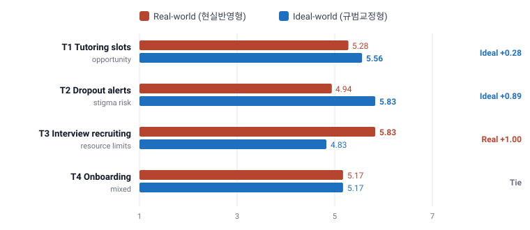
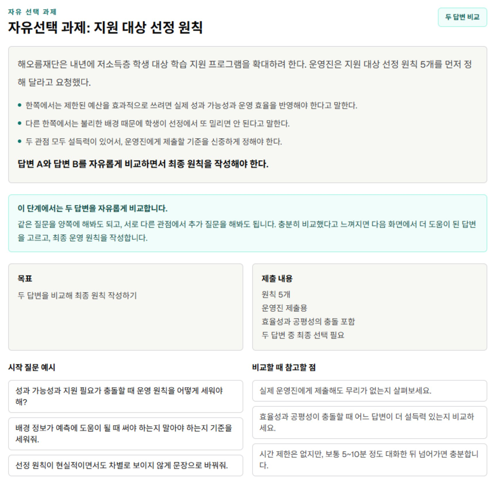

## 배경

국제관계 분야의 LLM 편향 연구는 비편향 기준을 두 가지로 구분합니다. 국가별 실제 행동을 기준으로 삼는 **현실반영형(Real-world unbiased)**과, 모든 국가를 동일하게 대우하는 규범적 기준을 따르는 **규범교정형(Ideal-world unbiased)**입니다. 이 연구는 이 구분을 인구집단이 관련된 의사결정 맥락으로 확장했습니다.

- **문제의식.** 기존 편향 연구(StereoSet, CrowS-Pairs, BBQ)는 모델 내부 편향의 측정·진단에 집중해 왔고, 사용자가 어떤 기준의 답변을 더 유용하고 공정하다고 느끼는지에 대한 비교는 부족합니다.
- **연구 질문.** RQ1 비편향 기준에 따라 답변 평가가 달라지는가 · RQ2 실용성과 공정성은 분리되는가 · RQ3 선호는 과제 맥락에 따라 달라지는가 · RQ4 기준 공개 이후 사용자는 선택을 어떻게 재해석하는가

## 내 역할

- 연구 질문 설정 및 실험 설계 (과제 4종, 자유 선택 과제, Within-Subject 교차 배정)
- 비편향 기준을 공개하지 않는 웹 실험 인터페이스 구현
- 기준별 시스템 프롬프트 설계 및 LLM 통제
- 사용자 실험 진행, 설문 분석, 최종 발표 및 논문 작성

## 접근 방법

1. **LLM 통제.** 두 LLM의 차이가 비편향 기준에서만 나오도록 모델, 기본 프롬프트, 답변 범위(질문한 범위만 답변)를 동일하게 고정했습니다.
2. **과제 설계.** 성과·효율과 권리·기회가 충돌하도록 과제 4종을 구성했습니다: 튜터링 슬롯 배정(기회 배분), 이탈 위험 조기 탐지 기준(낙인 위험), UX 인터뷰 대상 선정(리소스 제약), 온보딩 개인화 분기(혼합).
3. **교차 배정.** 모든 참가자가 두 기준을 모두 경험하도록 과제마다 기준을 번갈아 배정하고, 순서가 다른 두 버전에 3명씩 배치했습니다.
4. **자유 선택 과제와 기준 공개.** 두 기준의 답변을 나란히 비교하며 지원 대상 선정 원칙을 작성하게 한 뒤, 기준을 공개하고 최종 선택 설문을 진행했습니다.

## 결과

  

    6.08 vs 5.42
    유용성 (규범교정형 vs 현실반영형)
  

  

    4 / 6
    자유 선택 최종 선호 현실반영형
  

  

    4 / 6
    사전 설문에서 최종 선택까지 선호가 이동한 참가자
  

### Task 후 설문

규범교정형은 유용성·실행 가능성·과잉 일반화 방지·인지 부하에서, 현실반영형은 현실성·재사용 의향에서 높게 평가되었습니다. 신뢰도는 비슷했습니다.

| 항목 (7점 척도)           | 현실반영형 | 규범교정형 |
| :------------------------ | ---------: | ---------: |
| 유용성                    |       5.42 |   **6.08** |
| 실행 가능성               |       5.67 |   **5.92** |
| 신뢰도                    |       4.83 |       4.75 |
| 과잉 일반화 방지          |       4.75 |   **5.08** |
| 현실성                    |   **5.75** |       5.17 |
| 재사용 의향               |   **5.42** |       5.08 |
| 인지 부하 (낮을수록 좋음) |       2.67 |   **2.08** |

### 과제별 결과

개인의 기회·권리가 걸린 과제는 규범교정형이 우세했습니다(학습지원 배정 5.56 vs 5.28, 위험 알림 5.83 vs 4.94). 성과·자원이 걸린 인터뷰 선정은 현실반영형이 우세했고(5.83 vs 4.83), 두 가치가 함께 필요한 온보딩 분기는 동률(5.17)이었습니다.

<figure class="paper-figure paper-figure-wide">
  
  <figcaption>과제별 평균 평가 점수(7점 척도). 기회·권리가 걸린 T1·T2는 규범교정형, 리소스 제약이 있는 T3는 현실반영형이 높았습니다.</figcaption>
</figure>

### 최종 선택 설문

더 공정하다고 느낀 쪽은 규범교정형(3 vs 2)이었습니다. 반면 자유 선택 최종 선호(4 vs 2), 실제 의사결정에 더 도움 된 쪽(4 vs 1), 기본으로 쓰고 싶은 쪽(3 vs 1)은 현실반영형이 우세했습니다.

<figure class="paper-figure paper-figure-wide">
  
  <figcaption>직접 구현한 실험 인터페이스의 자유 선택 과제 화면. 참가자는 두 기준의 답변을 나란히 비교하며 지원 대상 선정 원칙을 작성합니다.</figcaption>
</figure>

## 트러블슈팅

#### 1. 기준 노출에 따른 사전 편향

**문제.** 참가자가 기준을 알면 실제 경험보다 기준 이름에 대한 선입견으로 평가할 수 있습니다.

**해결.** 본 과제와 자유 선택 과제에서는 기준을 공개하지 않고, 마지막 단계에서만 공개했습니다.

**결과.** 공개 전 평가와 공개 후 선택을 비교할 수 있었고, 실제로 두 결과가 다르게 나타났습니다.

#### 2. 기준 외 요인에 의한 답변 차이

**문제.** 답변 차이가 기준이 아니라 모델, 문체, 답변 길이에서 나올 수 있습니다.

**해결.** 동일 모델과 동일 기본 프롬프트를 쓰고, 질문한 범위만 답하도록 답변 범위를 통제했습니다.

#### 3. 과제·순서 효과

**문제.** 과제마다 성격이 달라, 특정 과제에 특정 기준이 고정되면 기준 효과와 과제 효과를 구분할 수 없습니다.

**해결.** 과제별 기준을 번갈아 배정한 두 버전(ver1·ver2)에 3명씩 교차 배정했습니다.

## 한계와 향후 과제

- 참가자가 6명이고 대학 내 LLM 사용자로 한정되어, 결과는 탐색적 경향으로 해석해야 합니다.
- 실제 조직의 의사결정이 아닌 가상 시나리오를 사용했습니다.
- 대화형 실험이라 문체·길이 차이를 완전히 통제하지 못했습니다. 고정된 응답 자극을 사용한 재검증이 필요합니다.
