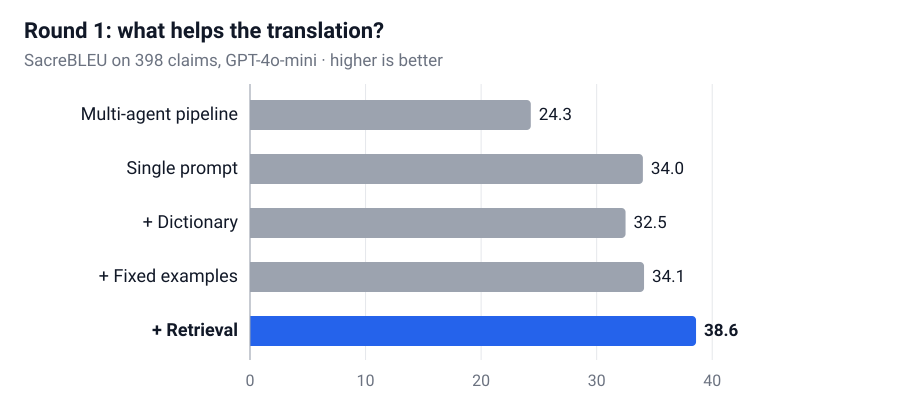

## 배경

특허 청구항은 발명의 권리 범위를 정하는 문장입니다. 미국 청구항은 한 문장으로 쓰기, 앞에 나온 구성 요소를 일관되게 가리키기 같은 USPTO 작성 관례를 따라야 해서, 단어 단위 번역보다는 새로 작성하는 일에 가깝습니다.

- **데이터.** 현대로템이 제공한 한국 청구항과 실제 미국에 출원된 영어 청구항 쌍 403개. 이 중 398개로 평가했습니다.
- **출발점.** 현대로템이 쓰던 프롬프트로는 청구항의 약 40%가 SacreBLEU 30점 이하였습니다. 오류는 세 가지였습니다. 기술 용어 오역, 특허 문체가 아닌 표현, 그리고 미국 청구항이 전략적으로 다시 작성된 경우입니다.

## 내 역할

- 실험 설계부터 고객사 전달까지 연구실 측 실무를 주도했습니다.
- 모든 실험을 설계하고 실행했습니다. 1차에서는 8가지 구성을, 2차에서는 구조화한 프롬프트를 여러 모델로 비교했습니다.
- 검색 파이프라인(Milvus, bge-m3)과 평가 파이프라인(SacreBLEU, PatClaimEval)을 만들었습니다.
- 오류를 분석하고, 고객사 미팅에서 결과를 발표하고, 청구항별 결과표를 전달했습니다.

## 접근 방법

**1차: 무엇이 실제로 도움이 되나?** GPT-4o-mini로 3단계 멀티에이전트 파이프라인(해석 → 번역 → 문체 다듬기)과 단일 프롬프트를 비교했습니다. 여기에 각각 용어 사전 힌트, 고정 예시 청구항, 가장 비슷한 청구항 쌍 5개 검색을 붙여봤습니다.

**2차: 더 나은 프롬프트.** 미국 청구항 작성 규칙을 명시한 구조화 프롬프트로 다시 쓰고 검색과 결합해, GPT-4o-mini와 Gemini 2.5 Flash로 비교했습니다.

**평가.** SacreBLEU는 실제 출원 청구항과 단어가 얼마나 겹치는지를 보고, 특허 청구항 품질을 판단하도록 학습된 모델인 PatClaimEval은 청구항으로서 올바른지를 봅니다. BLEU만으로는 오해가 생길 수 있어 두 지표를 함께 썼습니다(트러블슈팅 참고).

## 결과

  

    34.0 → 38.6
    검색 추가 시 SacreBLEU (1차)
  

  

    38.8 → 42.7
    구조화 프롬프트 + 검색 SacreBLEU (2차)
  

  

    70%
    2차에서 개선된 청구항 비율
  

### 1차: 검색은 도움이 되고, 에이전트를 늘리는 건 아니었습니다

<figure class="paper-figure paper-figure-wide">
  
  <figcaption>GPT-4o-mini로 진행한 1차 실험. "+"로 시작하는 줄은 단일 프롬프트에 도움을 하나씩 더한 결과입니다. 확실히 효과가 있었던 건 검색(파란색)뿐이었습니다.</figcaption>
</figure>

| SacreBLEU (398개)       | 기본 | + 용어 사전 | + 고정 예시 |   + 검색 |
| :---------------------- | ---: | ----------: | ----------: | -------: |
| 멀티에이전트 파이프라인 | 24.3 |        24.3 |        24.4 |        – |
| 단일 프롬프트           | 34.0 |        32.5 |        34.1 | **38.6** |

### 2차: 구조화 프롬프트

| 398개                            | SacreBLEU | PatClaimEval |
| :------------------------------- | --------: | -----------: |
| 기준 프롬프트 (GPT-4o-mini)      |      38.8 |         69.3 |
| 구조화 + 검색 (GPT-4o-mini)      |      42.7 |         70.2 |
| 구조화 + 검색 (Gemini 2.5 Flash) |  **43.3** |     **71.1** |

398개 중 280개(70%)가 기준 프롬프트보다 개선됐습니다.

## 트러블슈팅

#### 1. 멀티에이전트가 10점 낮음

**문제.** 해석 → 번역 → 다듬기를 에이전트로 나눈 파이프라인은 24.3점으로, 단일 프롬프트(34.0)보다 약 10점 낮았습니다.

**원인.** 단계마다 따로 호출하면서 단계 사이의 맥락이 끊겼습니다. 마지막 문체 단계는 첫 단계가 청구항 범위를 어떻게 해석했는지 보지 못했습니다.

**해결.** 해석, 번역, 작성 규칙을 한데 담은 구조화된 단일 프롬프트로 바꿨습니다.

**결과.** 단일 프롬프트가 이후 모든 개선의 기반이 됐고, 2차에서 42.7까지 올랐습니다.

#### 2. 용어 사전이 오히려 결과를 나쁘게 함

**문제.** 일반 한영 용어 사전(약 85만 항목)의 힌트를 넣자 SacreBLEU가 34.0에서 32.5로 떨어졌습니다.

**원인.** 이후 60개 청구항 어블레이션에서도 용어 사전 자체의 기여는 작았고, 한계는 검색 품질과 모델 자체에 있었습니다.

**해결.** 주 파이프라인에서 용어 사전 힌트를 빼고, 더 좋은 예시를 검색하는 데 집중했습니다.

**결과.** 검색 하나로 +4.6점, 가장 큰 개선을 얻었습니다.

#### 3. BLEU가 치명적 오류를 놓침

**문제.** 한 청구항에서 "양극(cathode)"이 "anode"로 번역돼 의미가 뒤집혔는데도 BLEU는 62.8이었습니다.

**원인.** BLEU는 단어 겹침만 세기 때문에 단어 하나가 틀려도 거의 안 떨어지고, 반대로 맞는 동의어에는 크게 감점합니다.

**해결.** PatClaimEval을 추가해 모든 청구항에서 두 지표를 함께 비교했습니다.

**결과.** PatClaimEval은 이 청구항에 낮은 점수(0.52)를 줬고, 결과를 두 지표로 함께 보고했습니다.

#### 4. 검색이 잘못된 표현을 끌어옴

**문제.** 가장 나빠진 경우에는 검색을 추가한 뒤 SacreBLEU가 73.8에서 49.3으로 떨어졌습니다.

**원인.** 검색된 예시가 "refrigerator" 자리에 "refrigeration unit"을 썼고, 모델이 그대로 따라 했습니다. 다른 모델(Claude, Gemini)도 이 청구항에서 점수가 떨어졌습니다.

**해결.** 기본 결과가 이미 좋으면 검색을 건너뛰는 방식(confidence gate)을 제안했습니다.

**결과.** 다음 단계로 고객사에 제안했고, 아직 구현하지는 않았습니다.

## 한계와 다음 단계

- 정답은 실제 미국에 출원된 청구항인데, 일부는 전략적으로 다시 작성된 것이었습니다. 완벽하게 번역해도 이런 청구항과는 정확히 일치할 수 없습니다.
- 검색은 같은 403개 안에서 했습니다(자기 자신은 제외). 비슷한 청구항끼리 겹치는 영향을 배제하려면 더 크고 분리된 데이터가 필요합니다.
- 특허 분류에 따라 예시를 고르는 방식과 2,000쌍 이상 확보 후 파인튜닝하는 2단계를 제안했지만, 고객사의 추가 데이터 제공이 전제였습니다.
