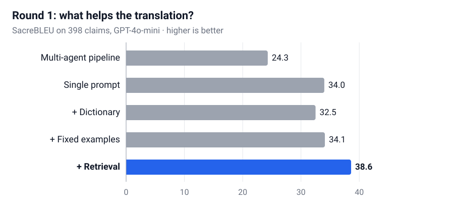

## 배경

특허 청구항은 발명의 권리 범위를 정의하는 문장입니다. 미국 청구항은 단일 문장 구성, 선행 구성 요소의 일관된 지칭 등 USPTO 작성 관례를 따라야 하므로, 단순 번역보다 재작성에 가까운 작업입니다.

- **데이터.** 현대로템이 제공한 한국 청구항과 실제 미국 출원 영문 청구항 403쌍. 이 중 398건을 평가에 사용했습니다.
- **기존 방식.** 현대로템의 특허 번역 전용 프롬프트 사용 시 청구항의 약 40%가 SacreBLEU 30점 이하였습니다. 주요 오류 유형은 기술 용어 오역, 특허 문체 미준수, 미국 출원 시 전략적 재작성으로 인한 불일치의 세 가지였습니다.
- **과제.** 일회성 점수 향상이 아닌, 재검증 후에도 유지되는 개선 기법의 선별.

## 내 역할

- 실험 설계부터 고객사 전달까지 연구실 측 실무 총괄
- 전체 실험 설계·수행 및 결과 검증 기준 수립
- 검색 파이프라인(Milvus, bge-m3) 및 평가 파이프라인(SacreBLEU, PatClaimEval) 구축
- 오류 분석, 고객사 미팅 결과 발표, 청구항별 결과표 전달

## 접근 방법

고객사 프롬프트를 기준으로 7개 기법을 검증했습니다. 기본 백본 모델은 GPT-4o-mini이며, 다른 모델을 사용한 경우에는 별도로 표기했습니다. 모든 결과는 아래 네 가지 기준을 충족한 경우에만 인정했습니다.

1. **평가 방식 통일.** 모든 출력을 동일한 후처리와 채점 기준으로 평가해 실험 간 수치를 직접 비교할 수 있도록 했습니다.
2. **유사 청구항 배제.** 검색 대상이 평가 데이터와 같은 403건이므로, 제목이 같거나 유사도 0.85 이상인 청구항은 검색 후보에서 제외했습니다.
3. **이중 지표 평가.** 단어 일치도는 SacreBLEU로, 청구항 품질은 특허 청구항 평가 모델인 PatClaimEval로 측정했습니다. 두 지표가 모두 개선된 경우에만 효과가 있다고 판단했습니다.
4. **통계적 검증.** 동일 조건 반복 실행 시의 편차(0.2점)를 측정하고, 주요 차이는 95% 신뢰구간과 함께 보고했습니다.

## 결과

  

    1 / 7
    두 지표 동시 개선 기법
  

  

    35.4 → 37.9
    RAG 적용 SacreBLEU (유사 청구항 배제)
  

  

    0.661 → 0.676
    RAG 적용 PatClaimEval
  

### 기법별 검증 결과

| 기법                                   | SacreBLEU   | PatClaimEval  | 판정                      |
| :------------------------------------- | :---------- | :------------ | :------------------------ |
| 멀티에이전트 분할 (3단계)              | 34.0 → 24.3 | –             | 제외                      |
| 용어 사전 힌트                         | 34.0 → 32.5 | –             | 제외                      |
| 고정 예시 (Few-shot)                   | 34.0 → 34.1 | –             | 효과 없음                 |
| **유사 청구항 검색 증강 (RAG, Top-5)** | 35.4 → 37.9 | 0.661 → 0.676 | **채택**                  |
| 유사도 기반 검색 게이팅                | 38.6 → 37.8 | –             | 제외                      |
| 구조화 프롬프트 + RAG                  | 37.9 → 36.5 | 0.676 → 0.653 | 제외                      |
| 상위 모델 (GPT-4.1-mini) + RAG         | 37.9 → 41.3 | 0.676 → 0.660 | 미채택 (SacreBLEU만 개선) |

상위 3개 항목은 고객사 보고 당시의 1차 실험 수치입니다. 나머지는 통일된 평가 기준에 따른 수치이며, 이 기준에서 고객사 프롬프트 단독 성능은 35.4입니다.

<figure class="paper-figure paper-figure-wide">
  
  <figcaption>1차 실험 결과 (GPT-4o-mini). "+" 항목은 단일 프롬프트에 각 기법을 추가한 결과이며, 유의미한 개선은 검색 증강(파란색)에서만 나타났습니다.</figcaption>
</figure>

### 모델·프롬프트 비교 (최종 실험)

| 구성 (398건)                        | SacreBLEU | PatClaimEval |
| :---------------------------------- | --------: | -----------: |
| GPT-4o-mini, 검색 미적용            |      35.4 |        0.661 |
| GPT-4o-mini + RAG                   |      37.9 |    **0.676** |
| GPT-4o-mini + 구조화 프롬프트 + RAG |      36.5 |        0.653 |
| GPT-4.1-mini, 검색 미적용           |      39.4 |        0.654 |
| GPT-4.1-mini + RAG                  |      41.3 |        0.660 |
| GPT-4.1 + RAG                       |  **41.8** |        0.663 |

RAG 적용 구성은 모두 유사 청구항 배제 조건입니다. 동일 모델 내 RAG 효과는 GPT-4.1-mini 기준 SacreBLEU +1.9(95% 신뢰구간 +1.2~+2.6)입니다. 두 지표가 모두 유의미하게 개선된 구성은 GPT-4o-mini + RAG가 유일하며, 비용도 가장 낮아 최종 구성으로 제안했습니다.

## 트러블슈팅

#### 1. 유사 청구항에 의한 데이터 누수 검증

**문제.** 검색 대상과 평가 데이터가 같은 403건이므로, 동일 특허 계열의 유사 청구항이 사실상 정답을 제공했을 가능성이 있었습니다.

**원인.** 59건이 제목이 같은 청구항을 예시로 검색했으며, 검색 예시의 유사도가 높을수록 향상 폭이 컸습니다(유사도 상위 46건 +9.4점).

**해결.** 제목이 같거나 유사도 0.85 이상인 청구항을 검색 후보에서 제외해 재실험했습니다. 실행 간 편차 측정을 위해 기존 조건도 재실행했습니다.

**결과.** SacreBLEU 37.9(기존 조건 재실행 38.9, 실행 간 편차 0.2, 검색 미적용 35.4). 청구항의 64%에서 개선이 유지됐고, PatClaimEval도 동일했습니다(0.676 대 0.677). 향상분 중 약 1점이 유사 청구항의 영향이며, 나머지는 실제 효과로 확인됐습니다.

#### 2. 구조화 프롬프트 성능 재현 실패

**문제.** 미국 청구항 작성 규칙을 명시한 구조화 프롬프트가 2차 실험에서 고객사 프롬프트 대비 약 4점 높게 보고됐습니다.

**원인.** 해당 향상은 재현되지 않았습니다. 저장된 2차 실험 결과를 통일된 평가 기준으로 재채점한 결과 38.3~38.5로, 고객사 프롬프트 + RAG와 동등한 수준이었습니다.

**해결.** 두 프롬프트를 동일한 검색 조건, 모델, 평가 기준으로 재실험했습니다.

**결과.** 구조화 프롬프트가 두 지표 모두에서 열위였습니다(SacreBLEU 36.5 대 37.9, PatClaimEval 0.653 대 0.676). 최종 구성에는 고객사 프롬프트를 유지했습니다.

#### 3. 상위 모델의 지표 간 불일치

**문제.** GPT-4.1-mini 적용 시 SacreBLEU는 37.9에서 41.3으로 상승했으나, PatClaimEval은 개선되지 않았습니다(0.660 대 0.676).

**원인.** 상위 모델의 출력은 실제 출원 청구항과 표현이 더 가까워졌으나, 청구항 품질 평가에서는 우위가 확인되지 않았습니다. GPT-4.1과 GPT-4.1-mini 간 차이도 유의미하지 않았습니다(SacreBLEU +0.5, 95% 신뢰구간 −0.3~+1.2).

**해결.** 단일 지표 최고 구성을 선택하지 않고, 두 지표를 병기해 보고했습니다.

**결과.** 두 지표를 모두 개선하고 비용이 가장 낮은 GPT-4o-mini + RAG를 최종 구성으로 제안했습니다. 지표 간 불일치의 해석에는 변리사 검토가 필요합니다.

#### 4. BLEU의 치명적 오역 미검출

**문제.** "양극(cathode)"이 "anode"로 번역되어 의미가 반대가 된 청구항의 BLEU가 62.8이었습니다.

**원인.** BLEU는 단어 중복만 측정하므로, 핵심 단어 하나의 오역에는 둔감하고 정당한 동의어 사용에는 과도하게 감점합니다.

**해결.** PatClaimEval을 도입해 전체 청구항에 대해 두 지표를 병행 평가했습니다.

**결과.** PatClaimEval은 해당 청구항에 낮은 점수(0.52)를 부여했으며, 이후 모든 결과를 두 지표로 보고했습니다.

#### 5. 검색 예시의 부적절한 표현 전이

**문제.** 최악의 경우 RAG 적용 후 SacreBLEU가 73.8에서 49.3으로 하락했습니다.

**원인.** 검색 예시의 "refrigeration unit" 표현이 "refrigerator" 자리에 그대로 전이됐습니다. 다른 모델(Claude, Gemini)에서도 동일 청구항의 점수가 하락했습니다.

**해결.** 검색 예시와 입력 청구항의 유사도가 임계값 미만이면 검색을 생략하는 게이팅을 적용했습니다. 판단에는 유사도만 사용하고 정답은 참조하지 않았습니다.

**결과.** 효과가 없었습니다. 임계값 0.70에서 10점 이상 하락한 청구항은 6건에서 3건으로 감소했으나, 평균은 38.6에서 37.8로 하락했습니다. 유사도가 낮은 예시도 평균적으로는 성능에 기여하므로, 유사도만으로는 검색의 부작용을 사전에 판별할 수 없었습니다.

#### 6. 멀티에이전트 및 용어 사전 적용 시 성능 저하

**문제.** 해석 → 번역 → 문체 교정의 3단계 멀티에이전트 구성은 24.3점으로, 단일 프롬프트(34.0) 대비 약 10점 낮았습니다. 일반 한영 용어 사전(약 85만 항목) 힌트 적용 시에도 34.0에서 32.5로 하락했습니다.

**원인.** 단계별 개별 호출로 단계 간 맥락이 단절되어, 문체 교정 단계에서 청구항 범위 해석 결과가 반영되지 않았습니다. 용어 사전은 60건 대상 어블레이션에서도 기여도가 낮았습니다.

**해결.** 단일 프롬프트 구조를 유지하고, 검색 예시 품질 개선에 집중했습니다.

**결과.** 1차 실험에서 RAG 적용으로 +4.6점의 최대 개선을 확인했습니다.

## 한계와 향후 과제

- 정답 데이터인 실제 미국 출원 청구항 중 일부는 전략적으로 재작성된 것이므로, 정확한 번역으로도 완전한 일치가 불가능합니다.
- 유사 청구항은 제목과 유사도 기준으로 배제했으나, 제목이 다른 동일 특허 계열은 패밀리 정보 없이 식별할 수 없습니다. 분리된 별도 데이터셋을 통한 검증이 가장 확실합니다.
- 상위 모델에서 SacreBLEU와 PatClaimEval이 불일치했습니다. 변리사의 표본 검토를 통해 실제 품질을 반영하는 지표를 확인할 필요가 있습니다.
- 특허 분류 기반 예시 선택과 2,000쌍 이상 확보 후 파인튜닝을 2단계 과제로 제안했으며, 고객사의 추가 데이터 제공이 전제 조건이었습니다.
