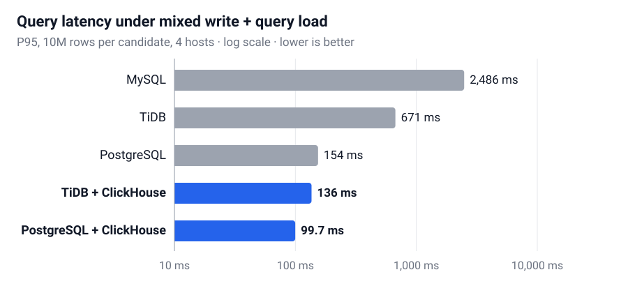

## 배경

철도 관제(CBTC) 시스템은 열차 상태와 이벤트를 끊임없이 저장하면서, 동시에 관제 화면과 AI 모델을 위한 분석 조회도 빠르게 처리해야 합니다. 이 시스템은 폐쇄망 온프레미스 환경에서 상용 분산 DB를 쓰고 있었고, 현대로템은 이를 오픈소스 구성으로 대체할 수 있는지 알고 싶어 했습니다.

- **실제 데이터 없음.** 운영 데이터는 외부로 반출할 수 없었고, 컬럼 정의서(테이블 약 45개, 컬럼 약 600개)만 받을 수 있었습니다.
- **고객사 기준.** 분석 조회 P95 50 ms 이하, P99 100 ms 이하, 12시간 안정 실행. 그 밖에 중복 처리, 데이터 신선도, 장애 복구, MySQL 호환을 요청받았습니다.

## 내 역할

- 연구실 측 실무를 주도하고 고객사와의 주 연락 창구를 맡았습니다. 3월부터 8월까지 모든 미팅에서 결과를 발표하고, 최종 인수인계서를 작성했습니다.
- 시뮬레이션 데이터 생성기를 만들었습니다.
- DB 벤치마크와 전체 데이터 흐름 테스트를 모두 설계하고 실행했습니다.
- 병목을 찾아 작업자 간 묶음 저장을 포함한 최적화를 구현했습니다.

## 접근 방법

**1. 실제와 비슷한 데이터 만들기.** 컬럼 정의서를 읽고 컬럼별 생성 규칙(값 목록, 범위, 형식)을 자동으로 추론하는 생성기를 만들었습니다. 마스터 테이블을 먼저 생성해 테이블 간 참조가 모두 유효하도록 했습니다. 열차 상태는 컬럼별 변화 확률에 따라 시간에 따라 바뀌고, 이벤트는 출퇴근 시간대에 몰리도록 했습니다.

**2. 후보 6가지 비교.** MySQL, PostgreSQL, TiDB, ClickHouse와 두 조합(TiDB + ClickHouse, PostgreSQL + ClickHouse)을 적재 속도, 쓰기·조회 동시 부하, 장애 전환, 중복 데이터 재처리로 비교했습니다.

**3. 전체 흐름 검증.** Kafka(토픽 73개) → 처리 작업자 → DB → ClickHouse → Parquet → AI 서버(모의)를 서버 2대와 PC 2대에서 초당 최대 1,000건까지 흘려 검증했습니다.

**4. 최적화와 12시간 실행.** 어디서 시간이 걸리는지 측정해 병목을 하나씩 해결하고, 최종 구성을 12시간 동안 실행했습니다.

## 결과

  

    2.9억 행
    44개 테이블, 참조가 모두 유효한 시뮬레이션 데이터
  

  

    219.9 → 18.3 ms
    최적화 후 분석 조회 P95
  

  

    2,457만 건
    12시간 동안 손실 없이 처리
  

### 단일 DB로는 두 가지 일을 함께 못 합니다

후보당 1,000만 행, 서버 4대 환경에서 단일 DB는 쓰기와 분석 조회를 동시에 받으면 크게 느려졌습니다. 분석용으로 ClickHouse를 붙이면 조회 지연이 낮게 유지됐습니다.

<figure class="paper-figure">
  
  <figcaption>쓰기와 분석 조회를 동시에 실행할 때의 조회 P95. ClickHouse를 붙인 구성(파란색)은 100 ms 안팎이고, MySQL 단독은 약 2.5초가 걸렸습니다. 로그 척도.</figcaption>
</figure>

| 후보            | 적재 (행/초) | 동시 부하 조회 P95 | 장시간 조회 P99 |
| :-------------- | -----------: | -----------------: | --------------: |
| MySQL           |       28,817 |           2,486 ms |       11,348 ms |
| TiDB            |       10,420 |             671 ms |          714 ms |
| PostgreSQL      |       33,484 |             154 ms |          308 ms |
| TiDB + CH       |       27,067 |             136 ms |     **66.2 ms** |
| PostgreSQL + CH |       33,059 |        **99.7 ms** |          112 ms |

### 12시간 연속 실행

최종 구성은 2,457만 건을 재시작이나 저장 실패 없이 모두 처리했습니다. TiDB와 ClickHouse의 행 수와 검증값이 일치했고, 조회 지연은 P95 26.46 ms, P99 77.01 ms로 고객사 기준을 충족했습니다.

**고객사에 전달한 권고:** TiDB + ClickHouse. TiDB는 MySQL 프로토콜을 지원해 기존 코드 수정이 적고, 노드를 추가해 확장할 수 있습니다. PostgreSQL + ClickHouse도 기준을 통과해 대안으로 정리했습니다.

## 트러블슈팅

#### 1. 분석 조회가 목표보다 4배 느림

**문제.** 부하가 걸리면 분석 조회 P95가 219.9 ms로, 목표 50 ms의 4배를 넘었습니다.

**원인.** 조회할 때마다 ClickHouse에서 전체 메시지 이력을 다시 집계해서, 데이터가 쌓일수록 느려졌습니다.

**해결.** 데이터가 들어올 때 갱신되는 Kafka 토픽별 요약 테이블(최대 73행)을 두고, 조회가 이 테이블을 보도록 바꿨습니다.

**결과.** 조회 P95가 **18.3 ms**로 줄었습니다.

#### 2. 작업자를 늘려도 Kafka 적체가 줄지 않음

**문제.** 처리 작업자를 1개에서 16개로 늘려도 메시지 적체가 줄지 않았고, 6개 부하 조건 중 3개에서는 최대 적체가 오히려 늘었습니다.

**원인.** 64분짜리 시험으로 5가지 변형을 비교해 보니, 적체를 좌우하는 건 작업자 수가 아니라 한 번에 DB에 쓰는 행 수였습니다. 작업자마다 한 번에 8행 정도씩만 쓰고 있었습니다. 읽기·쓰기 스레드를 나누는 방안은 쓰기가 1.9배 느려져 버렸습니다.

**해결.** 작업자들의 행을 모아 함께 쓰는 묶음 저장을 도입했습니다(작업자 20개 → 4개, 묶음 100행, 최대 대기 400 ms).

**결과.** DB 쓰기 호출이 **14.3배** 줄고, 최대 적체가 11,894건에서 1,406건으로 **8.5배** 줄었습니다. 대신 평상시 적체는 조금 늘었습니다(중앙값 93 → 194건).

#### 3. 첫 12시간 실행이 중간에 멈춤

**문제.** 첫 12시간 실행에서 저장 노드가 메모리 부족으로 재시작했고, 요약 테이블이 약 12시간 동안 갱신되지 않았습니다.

**원인.** 저장 노드의 캐시와 메모리에 상한이 없었고, 자동 통계 수집이 부하를 더했으며, ClickHouse 동기화가 한 번에 처리하는 양에 제한이 없었습니다.

**해결.** 저장 노드에 메모리 상한을 두고, 자동 통계 수집을 끄고, ClickHouse 동기화를 한 번에 5초·20묶음으로 제한했습니다.

**결과.** 재실행에서 재시작 0회, 요약 갱신 최대 공백이 99초로 줄었고, 서버 메모리 P95가 98.7%에서 77.5%로 낮아졌습니다.

## 한계와 다음 단계

- 모든 검증은 시뮬레이션 데이터와 연구실 장비에서 했습니다. 실제 운영에 적용하려면 실제 데이터와 장비로 다시 측정해야 합니다.
- 남은 최대 적체 1,406건은 연구실 내부 목표인 1,000건보다 높습니다.
- 저장 서버로의 파일 전송, 장비 단위 장애 전환 같은 운영 항목은 연구실에서 시험할 수 없어 남은 과제로 인계했습니다.
