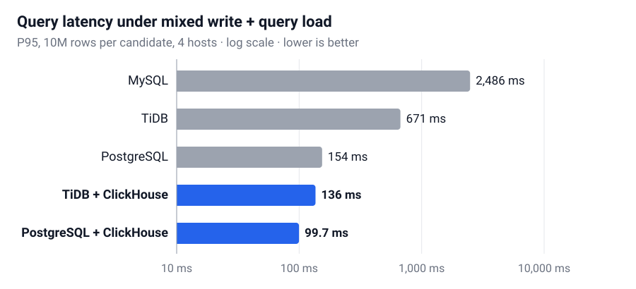

## 배경

철도 관제(CBTC) 시스템은 열차 상태와 이벤트를 지속적으로 저장하는 동시에, 관제 화면과 AI 모델을 위한 분석 조회를 빠르게 처리해야 합니다. 해당 시스템은 폐쇄망 온프레미스 환경에서 상용 분산 DB를 사용하고 있었으며, 현대로템은 이를 오픈소스 구성으로 대체할 수 있는지 검증을 요청했습니다.

- **데이터 제약.** 운영 데이터는 외부 반출이 불가해, 컬럼 정의서(테이블 약 45개, 컬럼 약 600개)만 제공받았습니다.
- **고객사 기준.** 분석 조회 P95 50 ms 이하, P99 100 ms 이하, 12시간 안정 실행. 추가 검증 항목으로 중복 처리, 데이터 신선도, 장애 복구, MySQL 호환성을 요청받았습니다.

## 내 역할

- 프로젝트 리더(PL) 및 고객사 주 연락 창구 (3월~8월 전체 미팅 결과 발표, 최종 인수인계서 작성)
- 컬럼 정의서 기반 시뮬레이션 데이터 생성기 및 정합성 검증기 개발
- DB 후보 벤치마크 및 전체 데이터 흐름 검증 설계·수행
- 병목 분석 및 공동 묶음 저장 등 성능 최적화 구현

## 접근 방법

1. **시뮬레이션 데이터 생성기 개발.** 운영 데이터 반출이 불가해, 컬럼 정의서(45개 테이블)를 기반으로 마스터 → 운행 계획 → 상태·이벤트 순의 3단계 생성기를 구축했습니다. 정의서의 타입·범위·코드값을 반영하고, 정의가 불충분한 컬럼은 운영 시나리오 가정(편성 수, 운영 시간, 출퇴근 피크)으로 보완했습니다. 열차 상태는 컬럼별 변화 확률 기반 시계열로, 이벤트는 피크 시간대 가중치를 적용해 생성했으며, 참조 무결성·시간 순서·피크 분포·위치-객체 정합성을 점검하는 검증기를 함께 구현했습니다.
2. **DB 후보 비교.** MySQL, PostgreSQL, TiDB, ClickHouse 단독 구성과 TiDB + ClickHouse, PostgreSQL + ClickHouse 조합 등 6종을 적재 성능, 쓰기·조회 동시 부하, 장애 전환, 중복 데이터 재처리 기준으로 비교했습니다.
3. **전체 데이터 흐름 검증.** DB 단위 성능 비교만으로는 운영 적합성을 판단할 수 없어, 고객사 요청에 따라 검증 범위를 운영 흐름 전체로 확장했습니다. Kafka(토픽 73개) → 처리 작업자 → DB → ClickHouse → Parquet → AI 서버(모의)를 서버 2대와 PC 2대에 구성하고, 초당 최대 1,000건 부하로 검증했습니다.
4. **최적화 및 장시간 안정성 검증.** 구간별 처리 시간 측정으로 병목을 식별·해결하고, 최종 구성을 12시간 연속 실행했습니다.

## 결과

  

    2.9억 행
    시뮬레이션 데이터 (44개 테이블, 참조 무결성 100%)
  

  

    219.9 → 18.3 ms
    분석 조회 P95 (요약 테이블 도입)
  

  

    2,457만 건
    12시간 연속 실행 무손실 처리
  

### DB 후보 비교: 단일 DB의 동시 부하 한계

후보당 1,000만 행, 서버 4대 환경에서 단일 DB는 쓰기와 분석 조회를 동시에 처리할 때 조회 지연이 크게 증가했습니다. 분석 조회를 ClickHouse로 분리한 조합 구성은 낮은 조회 지연을 유지했습니다.

<figure class="paper-figure paper-figure-wide">
  
  <figcaption>쓰기·분석 조회 동시 실행 시 조회 P95 (로그 척도). ClickHouse 조합 구성(파란색)은 100 ms 내외, MySQL 단독은 약 2.5초를 기록했습니다.</figcaption>
</figure>

| 후보            | 적재 (행/초) | 동시 부하 조회 P95 | 장시간 조회 P99 |
| :-------------- | -----------: | -----------------: | --------------: |
| MySQL           |       28,817 |           2,486 ms |       11,348 ms |
| TiDB            |       10,420 |             671 ms |          714 ms |
| PostgreSQL      |       33,484 |             154 ms |          308 ms |
| TiDB + CH       |       27,067 |             136 ms |     **66.2 ms** |
| PostgreSQL + CH |       33,059 |        **99.7 ms** |          112 ms |

### 장애 및 분산 환경 검증

물리 서버 4대에 후보별 클러스터를 분산 구성하고, 노드 장애와 서버 전환 상황을 시험했습니다.

- **노드 장애.** TiDB 저장 노드 1대를 30초간 정지한 상태에서 쓰기 2,450회·읽기 214회를 모두 실패 없이 처리했습니다.
- **장애 전환.** TiDB 저장·SQL 계층, PostgreSQL·MySQL 주/복제 서버, ClickHouse 복제본 장애에서 모든 후보가 쓰기·읽기 실패 0건을 기록했습니다. 다만 주 서버·게이트웨이 장애 시 쓰기 P99가 23~30초까지 증가했습니다.
- **부하 중 복구.** 전체 데이터 흐름 실행 중 장애 복구 시험 14건(6월 6건, 7월 8건)이 모두 30.6~37.6초 내에 복구됐으며, 10·50·100% 부분 전환과 복귀에서도 누락·중복이 발생하지 않았습니다.
- **분산 비용.** 서버 4대 환경의 TiDB 적재 속도는 10,420행/초로, 단일 서버(32,902행/초)의 약 1/3 수준이었습니다. 서버 간 복제 합의(Raft) 비용에 따른 차이로 판단되며, 운영 환경 용량 산정 시 반영이 필요한 항목입니다.
- **최종 클러스터 구성.** TiDB(저장 노드 3, PD 3, SQL 노드 1) + ClickHouse + Redpanda(Kafka 호환).

### 전체 데이터 흐름 검증

상위 2개 조합(TiDB + CH, PostgreSQL + CH)을 동일 입력으로 비교한 42건의 실험에서 데이터 정합성·순서·재처리 검증을 모두 통과했고, 부하 중 장애 복구 시험 8건도 30.6~37.6초 내에 전부 복구됐습니다. 조회 P99 중앙값은 TiDB + CH 105.8 ms, PostgreSQL + CH 129.4 ms로, TiDB + CH를 조건부 권고하고 최적화를 진행했습니다.

### 12시간 연속 실행

최종 구성은 2,457만 건을 서비스 재시작이나 저장 실패 없이 전량 처리했습니다. TiDB와 ClickHouse 간 행 수와 검증값이 일치했으며, 연속 쓰기 중 조회 지연은 P95 26.46 ms, P99 77.01 ms로 고객사 기준을 충족했습니다.

**최종 권고:** TiDB + ClickHouse. TiDB는 MySQL 프로토콜 호환으로 기존 코드 수정 범위가 작고, 노드 추가를 통한 수평 확장이 가능합니다. PostgreSQL + ClickHouse는 성능 기준을 통과한 대안으로 정리했습니다.

## 트러블슈팅

#### 1. 분석 조회 지연의 목표치 초과

**문제.** 부하 조건에서 분석 조회 P95가 219.9 ms로, 목표치 50 ms의 4배를 초과했습니다.

**원인.** 조회 시마다 ClickHouse에서 전체 메시지 이력을 재집계해, 데이터 누적에 따라 지연이 증가했습니다.

**해결.** 데이터 유입 시점에 갱신되는 Kafka 토픽별 요약 테이블(최대 73행)을 도입하고, 조회 대상을 요약 테이블로 변경했습니다.

**결과.** 조회 P95 **18.3 ms**로 단축했습니다.

#### 2. 작업자 증설 시 Kafka 적체 미해소

**문제.** 처리 작업자를 1개에서 16개로 증설해도 메시지 적체가 해소되지 않았고, 6개 부하 조건 중 3개에서는 최대 적체가 오히려 증가했습니다.

**원인.** 64분 단위 파일럿으로 5개 변형을 비교한 결과, 적체를 결정하는 요인은 작업자 수가 아닌 1회 DB 쓰기당 행 수였습니다. 작업자당 1회 쓰기 행 수가 약 8행에 불과했습니다. 읽기·쓰기 스레드 분리안은 쓰기 시간이 1.9배 증가해 기각했습니다.

**해결.** 작업자 간 행을 모아 일괄 저장하는 공동 묶음 저장을 도입했습니다(작업자 20개 → 4개, 묶음 100행, 최대 대기 400 ms).

**결과.** DB 쓰기 호출 **14.3배**, 최대 적체 11,894건 → 1,406건(**8.5배**) 감소. 반대로 평상시 적체는 소폭 증가했습니다(중앙값 93 → 194건).

#### 3. 12시간 연속 실행 중 저장 노드 재시작

**문제.** 1차 12시간 실행에서 저장 노드가 메모리 부족으로 재시작했고, 요약 테이블 갱신이 약 12시간 중단됐습니다.

**원인.** 저장 노드의 캐시·메모리 상한 미설정, 자동 통계 수집에 의한 부하 가중, ClickHouse 동기화의 1회 처리량 무제한이 복합적으로 작용했습니다.

**해결.** 저장 노드 메모리 상한 설정, 자동 통계 수집 비활성화, ClickHouse 동기화 1회 처리량 제한(5초·20묶음)을 적용했습니다.

**결과.** 재실행에서 재시작 0회, 요약 갱신 최대 공백 99초, 서버 메모리 P95 98.7% → 77.5%로 개선됐습니다.

## 한계와 향후 과제

- 모든 검증은 시뮬레이션 데이터와 연구실 장비 기준으로, 운영 적용을 위해서는 실제 데이터와 운영 장비 기준의 재측정이 필요합니다.
- 잔여 최대 적체 1,406건은 연구실 내부 목표치 1,000건을 초과합니다.
- 저장 서버 파일 전송, 장비 단위 장애 전환 등 연구실 환경에서 시험할 수 없는 운영 항목은 후속 과제로 인계했습니다.
